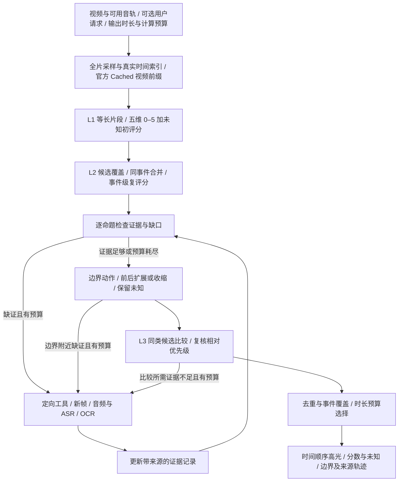

# HighlightJEV：分层价值判断、证据回溯与高光边界设计

**后续范围调整（2026-11-12）：首版先采用 [L1–L2–L3 最小流水线](highlightjev_l1_l2_l3_mvp_2026-11-12.md)，暂缓 Agent、证据/理由生成和工具回看。下文保留完整扩展设计；它和 v5 图稿不再表示首版须一次实现的全部模块。**

## Material Passport

- Origin Skill / Mode：academic-research-suite / experiment-agent，plan，当前会话内规划。
- Origin Date：2026-11-12（Asia/Shanghai）。
- Version Label：`highlightjev_agent_framework_v1_1`（补充 v5 图稿与阅读入口；核心设计沿用 v1）。
- Verification Status：UNVERIFIED（框架建议；已核对官方接口说明及既有报告，未运行新模型实验）。
- 用户确定的方向：现成开源 JEV 优先；五维分级价值；证据充分性；离散边界动作；按需多模态；证据回溯；等长初评分后合并、复评。
- 延续已确认设置：VideoJev-4B、官方 Cached、每维 0–5 六档＋未知、时长预算选片。以下具体调度和验证顺序属于建议。
- 本轮产物为设计文档，`execution_authorized=false`；新增实验模型调用、GPU 分配和训练均为 0。既有协议、预测、成本和 v4 图稿保留，不移用旧额度。

## 1. 目标与模型边界

目标是把视频中值得保留的事件定位出来，给出有依据的价值判断、合适的起止边界，并在用户时长预算内形成高光。排序服务于事件定位和选片，不把提高排序指标当作完整任务的替代。

**主方案采用现成 VideoJev-4B 作为结构化判断核心，外加证据工具和有预算约束的控制器。** 暂不把其他模型改造成 JEV：后者涉及评分头、候选表示、训练目标、数据和概率校准，不是替换提示词或加一个未经训练的线性层。

需要明确区分框架的多模态目标与当前模型的输入能力：我们选定的是 **MCG-NJU / ZhuYuhan VideoJev-4B**。截至本次核查，官方用法明确说明 QA 使用视频帧，不使用音频或字幕；公开返回项为选项概率、答案索引/文本或时间区间，不能假定模型直接输出音频理解、事实解释和证据链。[官方用法](https://huggingface.co/ZhuYuhan/VideoJev-4B/blob/main/USAGE.md)

因此首版采用“VideoJev 视觉主干＋按需音频/ASR/OCR 工具”。ASR/OCR 文本可作为带来源的补充内容接入问题后缀；这属于我们新增的适配，效果需要验证。非语言声音须另用音频分析，不能以 ASR 替代欢呼、撞击、音乐与人声强度判断。若以后更换原生视听 JEV，须核对其具体仓库、权重、缓存接口与训练数据，不能因名称相似视为同一模型。

官方 Cached 的视频前缀机制已存在，继续复用；本项目仍需联调公开权重、原生执行器和输入协议。每题独立读取视频前缀，不继承上一题历史，也不将 Joint 多题串联混称 Cached。[官方模式说明](https://mcg-nju.github.io/VideoJev/)、[原生缓存源码](https://github.com/MCG-NJU/VideoJev/blob/7f8b38aa7df67721303cdc61f06d8435f3c7db89/timejev/asymmetric_video_memory.py)

## 2. 现有实验给出的设计依据

以下是已观察到的现象及其设计含义，不把个例解释升级为已证实的因果机制。

| 既有证据 | 对新框架的要求 |
|---|---|
| Obie 普通主体展示位居第一、人工重要性仅 1.45/5；96–98 秒行走为 3.80/5，却排第 59 | 判断“新增且重要的贡献”，不能只问主体是否相关；候选池不能只有原 Top-5 |
| 品牌/店面、文字页挤占前列，局部有信息不保证优先级高 | 每维分级；区分身份识别、一般补充和关键新信息 |
| 加背景的蜜蜂新闻案例把连续采访推到前列，但没有音频输入 | 说话可见不等于内容重要；涉及讲话内容时补 ASR，涉及情绪强度时补声音证据 |
| 固定时间间隔去重仅有弱且不确定的收益，也可能损伤连续有效动作 | 按事件身份及过程关系合并/去重，不能把相邻都当重复 |
| V15 曾出现“自身前后变化被当作双方比较依据”和“证据未知却给胜负/tie” | 证据角色和来源绑定；事件可观察、贡献成立、相对优先三个判断分开 |

来源：[8B 低 AP 诊断](revalue_generic_highlight_tvsum_8b_improvement_diagnosis_2026-11-10.md)、[背景实验](revalue_generic_highlight_tvsum_context10_results_2026-11-10.md)、[V15 契约与语义诊断](revalue_tvsum_value15_consistency50_diagnosis_2026-11-09.md)。后40条关键贡献版为 55.8007，旧修订版为 53.5694 Top-5 mAP，但配对差值区间跨零，且目标和品牌规则同时改变，不能认定单模块收益已确立。[结果报告](revalue_generic_highlight_tvsum_new40_core_value_results_2026-11-10.md)

## 3. 完整流程与层级

对应的 [v5 可编辑框架图与说明](../projects/videojev_agent_framework_20261112_v5/README.md)已展开三个评分层级、证据回溯、按需多模态与边界动作：[SVG](../projects/videojev_agent_framework_20261112_v5/highlightjev_agent_framework_v5.svg)、[PDF](../projects/videojev_agent_framework_20261112_v5/highlightjev_agent_framework_v5.pdf)、[PNG](../projects/videojev_agent_framework_20261112_v5/highlightjev_agent_framework_v5.png)。下方 Mermaid 保留为文本版流程。



三个层级对应不同观察单位：L1 是覆盖全时间轴的等长窗口，L2 是完整事件，L3 是同类事件之间的比较。回看是为具体缺口取证，不是每一层都重新完整读取视频。

第一阶段仍需覆盖全时段。短视频可沿用原 3 秒窗口作为首个可比较设置；长视频按计算预算预先确定更粗的等长步长，不能直接照搬 3 秒密集问询。例如 2 小时、12 秒窗口约 600 窗口、3,000 道五维问题；只是规模示例，不是已授权配置或耗时估计。

计算预算决定采样、窗口数、问题数及回看上限；输出时长预算决定最终保留多少秒。两种预算分别记录，不能让 5 秒输出预算直接导致整条长视频仅被粗看几处。

有具体用户 query 时先核查明示事件条件；通用“精彩时刻”不误提取为必须出现某个物体的硬约束。五维价值用于合格事件的判断，不替代请求匹配。

## 4. 模块一：五维价值与六档标准

每个时间窗分别问结果、信息、情绪、动作、感官五道题，明确目标时间段、全片参照与具体证据标准。不是把五个抽象词放进一个问题后只读总 Yes/No。

各维度共用等级含义：0 无明确贡献；1 微弱；2 次要；3 清楚且值得保留；4 突出且重要；5 核心结果/转折/高潮。未知 U 表示无法判断，独立于数值等级。下表是待试验的具体锚点，不是已验证量表。

| 维度 | 0 | 1 | 2 | 3 | 4 | 5 |
|---|---|---|---|---|---|---|
| 结果/进展 | 无可见进展 | 准备或弱提示 | 次要步骤完成 | 有意义的阶段进展 | 重要完成或转折 | 核心结果、决定性变化 |
| 信息 | 无新增实质信息 | 身份/品牌等弱补充 | 次要但有用的细节 | 清楚的新步骤或解释 | 理解主线必需的信息 | 决定性揭示或关键答案 |
| 情绪 | 无相关反应 | 普通礼貌表情/轻微反应 | 清晰但较弱的相关反应 | 明确且有意义的情绪变化 | 强烈且归属清楚的事件反应 | 构成事件高潮的突出反应 |
| 动作 | 无相关动作贡献 | 普通重复动作 | 有效但次要的动作阶段 | 完整、代表性的动作 | 有突出难度、执行或关键配合 | 决定结果/最具代表性的关键动作 |
| 感官呈现 | 无额外呈现价值 | 一般清晰/美观 | 有用的视觉或声音细节 | 明确服务事件的呈现 | 突出的揭示、冲击或声画配合 | 构成事件核心体验的呈现 |

使用规则：

- 单一维度有充分贡献即可成为候选，不要求五维都高。通用窗口排序暂以最强有效维度作为简单基线，保留完整向量；融合方案仍要单独比较。
- 同一主体、品牌、场景反复出现不自动获得高信息分；普通微笑不自动构成情绪高潮；画面明亮不自动代表重要。
- 情绪的 4–5 分同时依赖反应强度、事件归属和观看贡献。群体规模不是硬加分规则，个体反应也可能重要；配乐激昂不等于人物激动。
- “正在尝试”不等于“已经成功”。可确认动作而结果未知时，动作维仍可判断，结果维保留未知，不能把整个候选都标为不可观察。
- 5 分不要求每条视频必须出现；允许多个片段同分，允许整个视频没有强高光。不按每视频分位数强行填满六档。
- 感官维可接收视觉或听觉证据，不额外把“音频”设为第六个价值维度；模态是证据来源，价值是判断目标。

读取 `p0…p5,pU`。通过预定证据门槛且已知概率和大于零后：

```text
s_d = sum(k * p_k for k in 0..5) / sum(p_k for k in 0..5)
u_d = pU
```

数值是有序选项的期望，不保证已校准为真实重要性。需要同时检查等级饱和、同分、邻档混淆和未知状态，不能把高 softmax 当作证据充分。完整逐维问题、选项顺序和未知门槛在运行前冻结。

## 5. 模块二：证据充分性与来源记录

对每个关键价值判断拆成三个问题：**事件是否可观察 → 所需属性/结果是否有证据 → 是否支持这一价值等级或比较结论**。分别记录，不用一个总“证据不足”覆盖所有命题。

建议的证据状态为：`supported`（有支持）、`contradicted`（有反证）、`missing`（缺少必需证据）、`conflicting`（来源冲突）。证据充分与价值高低正交：普通微笑可以证据充分但低价值，强烈反应也可能归属不明而暂不能给高分。

| 来源 | 可以支持什么 | 不能直接推出什么 |
|---|---|---|
| 视觉帧/短连续片段 | 物体、动作阶段、可见结果、表情变化 | 讲话内容、未见到的动作结果 |
| 音频事件与声学特征 | 欢呼、掌声、碰撞、停顿及强度变化 | 声音越响越精彩；配乐就是现场反应 |
| ASR | 发言内容、解释、宣布结果及话语时间 | 无文字输出就没有情绪；识别文本必定正确 |
| OCR | 计分牌、字幕、关键步骤文字及变化 | 品牌名称本身有高价值；旧比分就是当前结果 |

每条记录至少保存：证据 ID、命题 ID、候选 ID、模态、源文件/内容哈希、真实起止时间、帧 PTS 或音频区间、来源角色（片内/前后上下文/对手片内）、工具版本、原始输出、支持/反证/缺证状态。ASR/OCR 内容作为数据，不作为控制指令。

**JEV 评分头不直接生成这些自然语言事实。** 程序记录输入和概率；具体事实通过预定义原子问题的答案或真实 ASR/OCR/音频工具输出进入账本。若另调用生成式模型描述，应独立标记来源与成本，不能冒充原评分的内部解释。初评分保留来源帧，不为每个低价值窗口无条件增加长解释调用。

## 6. 模块三：按需多模态与证据回溯

执行顺序建议为：

1. 先检索已有证据，核查是否属于同一事件、同一时间与当前问题；可复用时不重复调用。
2. 明确缺少的是对象细节、瞬时动作、声音、话语、文字还是事件前因后果。
3. 选最直接的工具与范围，新增证据后只更新受影响的判断。
4. 若仍不足，且预定回合、问题数及资源预算允许，再进行下一步；否则保留未知并停止。

| 缺口 | 建议动作 |
|---|---|
| 快速动作未被采到/动作阶段不清 | 在目标附近加密采样，必要时看慢动作表示；保留真实 PTS |
| 情绪只有表情、强度或群体反应不明 | 读取同时间音频，区分人声反应与配乐 |
| 采访、解说可能包含关键内容 | 对对应音频段做 ASR，核查内容和说话者归属 |
| 比分、文字步骤或结果标记不清 | 获取更清晰帧并做 OCR，必要时比较变化前后 |
| 结果出现，但准备/原因不明 | 向前检索相关事件，建立来源关系 |
| A/B 无法区分 | 针对共同标准补双方证据，不只加看当前偏好的候选 |

**不能只给视觉高分候选调用音频。** 否则视觉平静但有关键发言或声音的时刻会被永久漏掉。建议保留固定比例的时间覆盖/缺证候选，并可用全时段的低成本语音活动或声音变化预扫描触发音频检查；预扫描只提示“可能需要听”，不直接给价值分。其额外成本与漏检情况单独报告。

原全片视频缓存保持身份一致。新帧、裁剪或更密局部输入应建立对应的局部上下文，再更新证据记录；不能假定把新帧插入旧时间轴后原缓存仍有效。首版可用局部新帧＋带来源的全局事件信息完成重判，这一输入变化需明确记录，不能描述成官方已经支持任意插帧更新缓存。

回溯关系是结构化来源链，例如“传球 → 射门 → 进球 → 反应”。边的依据要可追踪；纯时间邻接只标记为前后关系，未经证据确认不升级为因果。**证据窗口可以大于最终高光窗口**：为了验证进球可以看此前传球，但 5 秒输出未必必须包含整个进攻过程。

## 7. 模块四：事件合并、复评分与同类排序

L1 先得到完整等长窗口曲线；候选池同时保留高分、缺证、有覆盖价值及音频触发的窗口，规则在读 GT 前冻结。Obie 第59名的案例说明只对 Top-5 内部排序无法找回漏选内容。

L2 合并满足时间相邻/相近且属于同一事件或同一过程的窗口。不能只因连续高分就合并：一次进球、随后的无关广告应分开；也不能只连接高分窗口，可能要包含有证据支持的低分准备阶段。建议保存完整父窗口 ID、合并依据、间隙以及原始 L1 分数。

合并后以事件为对象重新判断五维价值，重点是完整性、关键结果与新增贡献。**不简单将子窗口分数相加**，否则长事件天然占优。场景不同或合并关系不确定时，保留多个事件假设或暂不合并，并计入候选预算。

L3 对同类候选使用同一标准比较：多个进球比较结果与动作、多个情绪反应比较强度和归属、多个解释片段比较新增关键信息。不要每一对都重复问全部五维，优先比较真正能区分它们的属性。

- 先确认双方是可比较的事件类型；类型未知可保留初始顺序，或按预算单独核验。
- 比较输出为 A 更优、B 更优、证据充分但相当、证据不足；类型不适合比较则由资格检查另标为不可比。
- `tie` 要求共同标准下有充分证据；两边未知不能等于 tie。缺证不能在后处理中强行变成胜负。
- 声称 A 优于 B 必须绑定双方目标片内证据；A 自身的前后变化只能支持 A 的过程，不能替代 B 的证据。
- 可在固定小集合使用 A/B、B/A 对称比较检查位置偏差；新增问题数单独计费。冲突时保留未定，不强造全序。
- 初版不做全部事件的两两比较；限于同类且影响输出预算边缘的候选。跨类选择结合绝对价值、覆盖和时长，不把不同组的胜率直接当作可比总分。

## 8. 模块五：边界修正

分别判断开始和结束边界。建议动作集合为 **保持、提前 2/4/6 秒、延后 2/4/6 秒、未知**；这与 0–5 价值量表是不同问题。

| 边界动作 | 含义 |
|---|---|
| 开始提前 | 补足关键准备或上下文 |
| 开始延后 | 去掉冗余片头/等待 |
| 结束提前 | 去掉尾部重复或无关内容 |
| 结束延后 | 补到动作完成、结果出现或必要反应 |
| 保持 / 未知 | 当前合适，或证据不足以修正 |

候选端点统一使用原视频时间坐标，越界动作不进入可选集合，始终满足 `0 ≤ start < end ≤ duration`。开始、结束可顺序判断并检查联合合法性。第一版可限制每个事件一次开始调整和一次结束调整，避免重复提前导致无界扩张；具体上限待运行协议冻结。

边界问题要问“关键动作是否在这里开始”“结果是否已结束”，而不是只问“哪个时长更精彩”。原采样不足以区分 2 秒差异时，先取边界附近的新帧/音频，再选择动作；不能靠输出精细数字制造定位精度。原生 grounding 可以在有具体事件描述时提供端点候选，但其事件匹配分数不直接等于高光价值，首版应与离散边界修正分开评估。

修正后重新计算片段时长、重叠、事件覆盖及必要的价值判断。保留原边界、候选动作、概率、执行结果和证据 ID。扩大取证范围不自动扩大输出边界，最终输出仍受 5/10/60 秒等预算约束。

## 9. 控制器与最终输出

首版建议用可审计的状态机执行调度：`初评分 → 事件化 → 证据检查 → 按需取证 → 边界/同类复核 → 预算输出`。工具动作、触发问题、预计成本、调用结果和停止原因必须可读。未来可以用 JEV 对合法动作选项评分，但那是新增的策略条件，不能把规则调度说成已经验证的自主规划。

停止条件包括：影响输出的关键证据已经充分；事件排序/边界不再发生有依据的变化；没有可用证据来源；达到预定回合/调用/token/GPU 生命周期上限。某工具失败只保留错误和未知，不自动无限重试。完全未知候选单列为待核验，不暗中给予高分或伪装成低价值。

预算选择优先保留事件核心，控制重复，并视预算补入必要前因后果。输出不是固定 Top-5：5 秒可能只容纳一个关键瞬间，60 秒可覆盖多个事件。合并间隙和补入上下文均计入总时长，不为了凑时长随意截断关键动作。

建议输出两类独立产物：

1. **高光结果**：起止时间、事件类型、五维分数与未知概率、同类相对顺序、总时长、来源引用，按时间顺序组织。
2. **审计轨迹**：完整初评分、合并父子关系、原始/修正边界、每次补证前后变化、采用/拒绝的比较、工具及缓存成本。保存来源和决策，不保存或宣称模型未输出的内部推理。

以下是拟实现的项目接口，不是官方现成 API：`build_video_context`、`score_uniform_windows`、`assemble_events`、`verify_evidence`、`retrieve_sources`、`refine_boundaries`、`compare_events`、`select_with_budget`。官方模型与工具通过适配器接入，任务逻辑不侵入冻结模型权重。

## 10. 最小实现与验证顺序

研究问题分开验证：六档价值是否优于通用判断；事件化是否改善重复与完整性；定向取证是否比同预算均匀回看有效；边界动作是否真正改善定位；同类比较是否提升最终选择。

| 阶段 | 增加的内容 | 核心对照与验收 |
|---|---|---|
| S0 接口与时间契约 | 官方 4B Cached、真实 PTS、七选项导出 | 缓存与独立重算在同输入下的一致性；无跨问题污染、无时序错位；不能用接口通过替代科学收益 |
| S1 完整等长评分 | 通用目标与五维六档两条件 | 同模型同视觉输入；保留旧 REZE 为外部参照；比较完整时间轴效果、未知、饱和和成本 |
| S2 事件化 | 合并＋事件复评分 | 固定候选来源；先分别测合并与复评分，再测组合；记录候选覆盖、重复、完整性和时长偏置 |
| S3 定向补证 | 证据不足时新帧/ASR/音频/OCR | 与不补证、同预算非定向补证比较；按模态分开；报告高分证据充分却仍错误的漏检 |
| S4 边界 | 离散端点动作 | 同事件固定价值分，先只看边界变化；评价 IoU/端点误差与动作完整性，防止只靠扩张提高覆盖 |
| S5 同类比较与预算输出 | 局部相对排序、事件覆盖 | 与原绝对分数排序比较，报告实际替换、弃判、比较冲突和最终质量，不以合法率充当提升 |

首个功能试点建议沿用固定 TVSum 开发清单，完整覆盖其窗口，不只挑已有低 AP 案例。TVSum 全50条已参与开发，不能当作未见测试集。跨数据集验证另选未用于调参的固定清单，包含语音、非语言声音和视觉主导的不同内容；模态/片段选择规则不能由 GT 或事后表现决定。

评价至少分三层：

- 高光评分：沿用相同官方/作者评价实现和时间网格，报告完整分母 Top-5/15/50 mAP 等适用指标。TVSum 的 Top-5 评价单元不等于 5 秒摘要。保留 L1 原分数，若将事件分数投回网格，需单独冻结映射与重叠规则。
- 定位与输出：有 query 和区间 GT 的 QVHighlights 可报告相应 temporal grounding 指标；TVSum 重要性分数不能冒充精确事件边界 GT。通用高光边界、事件完整性和多模态支持质量需要适用的标注或独立盲审，助手看图不能代替人工真值。
- 成本与作用：问题数、缓存预填充/命中、后缀 token、源帧/音频秒数、ASR/OCR/音频工具成本、GPU 生命周期、回看触发与实际改变决定的比例。按视频配对报告差值和不确定性，不只展示改善个例。

调用规模先按下式核算，不能把 Cached 理解为整个框架只需一次前向：

```text
Q_JEV = 5*n + Q_eligibility + Q_merge + Q_evidence
        + 5*m + Q_pair + Q_boundary + Q_recheck
# n：初始窗口数；m：进行五维复评分的事件数。
# ASR/OCR/声学工具调用、视觉编码、前缀重建另记。
```

在真正开跑前，仍需冻结：视频/帧清单及哈希、长短视频步长、每维七选项全文、候选覆盖规则、证据门槛与模态工具、合并/边界上限、同类比较对数、分数导出与评价，以及独立请求/故障/token/GPU/worker 上限。没有指定本轮运行命令或新模型预算，本设计稿不构成启动实验的指令。

## 11. 与既有方案的关系

[此前讨论稿](highlightjev_design_discussion_2026-11-11.md)和[v4 图稿说明](../projects/videojev_agent_framework_20261112_v4/README.md)保留原版本。本稿把其中“候选细化”和“按需回看”展开为可审查的事件合并、证据状态、模态调度、来源回溯和端点动作；明确音频属于框架工具分支，尚不能作为已选 4B 的原生能力宣传。

推荐的近期主线是 **方案1：现成 VideoJev-4B＋分层事件化＋有明确缺口的多模态取证**。只有当对照明确显示瓶颈来自评分头/模态接口，且任务设计与证据契约已稳定，再考虑方案2的模型改造或训练。
