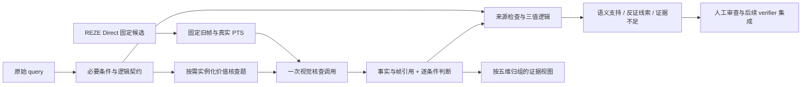

# ReVALUE 价值判断设计 v2：面向 Query 的可核查价值证据

## Material Passport

- Origin Skill: academic-research-suite / experiment-agent
- Origin Mode: plan，沿用本会话的 grounding 主线
- Origin Date: 2026-10-31
- Verification Status: UNVERIFIED（方法效果未验证；仅设计、资料核对和 CPU 文件检查）
- Version Label: value_judgement_design_v2
- 用户请求：借鉴现有方法，优化我们的价值判断设计。
- `execution_authorized=false`。本轮新增实验请求、实验 token、GPU 分配、GPU 秒、worker、重试上限均为 0。
- 本文细化[上一版改进方案](../../../revalue_verifier_improvement_plan_2026-10-31.md)，不覆盖旧协议、源码、结果或失败。v2 是设计版本，不是已经运行的 verifier 版本。

## 1. 核心决定与研究问题

把目前的“五个抽象价值字段”改成 **五类核查视角 → query 对应的具体问题 → 可引用证据 → 条件判断**。适用性由 query 契约确定，视觉模型回答证据是否成立，程序检查来源和条件逻辑。

研究问题：在相同候选、像素、query 条件、模型和输出契约下，维度专属的证据提示，是否比普通的逐条件核查更能找出真实语义错误，同时减少无依据的支持和误报？

这里保留 outcome / information / emotion / action / sensory 五类名称，但核查的是其与请求相关的证据。**“片段值得观看”和“片段符合 query”分别记录，不能相互替代。** 当前只验证后者；精彩程度、审美强度、跨候选排序不进入拒绝规则。人物、物体身份等基础条件也不能为了凑齐五类而被强行归类。

假设 H1：具体的支持/反证/缺证标准能改善条件核查。假设 H2：将任务适用性与画面可见性分开能减少错误 NA。假设 H3：依赖检查能减少“对象未确认、属性却已确认”的不一致。这些均未在我们的模型上得到受控验证。

## 2. 依据与借鉴边界

| 方法 | 已有机制 | 本设计采用的部分 | 保留的区别 |
|---|---|---|---|
| [VisionReward](https://arxiv.org/html/2412.21059v2#S2) | 多维评价拆成具体视觉判断题，并学习偏好权重 | 为每维编写可操作问题及支持、反证、缺证说明 | 不移植生成视频偏好权重；不把缺证强制二值化 |
| [UnifiedReward-Flex](https://arxiv.org/html/2602.02380v1#S3) | 根据输入形成具体评价细则；经 SFT、DPO 训练 | 根据 query 实例化细则 | 本版在观察候选前冻结要求；不根据哪个候选更容易得分新增标准，也不强制赢家 |
| [DSG](https://github.com/j-min/DSG/blob/main/README.md) | 原子问题和依赖图抑制不一致回答 | 显式表示主体、对象、关系与属性的依赖 | unknown、证据区域及时间作用域是我们的扩展；不把父节点缺证映射成所有子节点为假 |
| [VTune / temporal consistency](https://arxiv.org/html/2411.12951v1#S3) | 整体及主体、动作、关系核查；另有验证训练 | 核查具体语义成分，并单独评估验证是否可靠 | 不把自洽当真实，不将原论文经训练的收益归给原生 Qwen 提示 |

专家规则与维度专属监督的其他例子，见[已完成相关工作调研](../../../revalue_value_verification_related_work_2026-10-31.md)。本方案是方法设计的借鉴，尚无“现成模块替换即可有效”的证据，也没有新的独创性证明。

## 3. 需要解决的实际问题

沿用已完成的[离线诊断](../../../revalue_direct_verifier_offline_diagnosis_v1_2026-10-30.md)，不重跑：81 条合法记录包含 405 个价值字段，361 个 NA、0 个 unknown；61 条五项全 NA。没有独立价值标签，不能称为 89.14% 漏检率。

当前提示只有各维短释，示例五项全 NA，且 values 不直接影响报警。固定案例显示：把“相关但看不清”当成 NA；确认物体却漏查动作/内容；缺证问题没有阻止整体 supported。提示过短、默认示例诱导、多任务负担等仍是待检验原因。

58 个 invalid、边界方向错误也真实存在。它们需要公共实现修订，不能把这些修订与价值提示打包后，声称价值模块单独有效。

## 4. 模块结构及数据流

边界与事件覆盖属于并行问题。首个价值对照只输出语义核查，不调用新的边界分支，也不改旧边界判断。区间完整性、同次事件归属和精确时间修正留在公共 verifier 的独立工作项；语义 supported 不表示完整区间已验证。

### 4.1 Query 契约：先定要查什么

每个条件包含 `requirement_id`、原 query 的字符跨度、规范化问题、涉及的实体/同次事件、作用域、依赖、极性以及 AND/OR/时间关系。程序依据跨度取原文，不要求模型重复抄写原句。

原则：

1. 明示要求及其不可缺少的语义组成才能作为必要条件。不能从“射门”自动增加“进球”，不能从“庆祝”增加“必须有观众”。
2. AND、OR、否定和“之后”不能压平成任意条件全部成立；不确定的语义拆解标记 `contract_unresolved`，不悄悄删掉难项。
3. 同一人物、物体和事件必须绑定。不同时间看到“男子”“手机”“文章”，不能无关联地拼成该男子阅读该文章。
4. 基础身份与关系条件保留 `core` 类。五维只是检查视角，允许一条件关联多个视角，最终只判断一次，不能重复计票。
5. 最小开发对照先由研究者仅看 query 编写并复核公共契约，两臂共享。审阅者不看 GT、旧成绩或待比较响应。现在没有完成这批人工契约，不能宣称它们已冻结。

将来若用模型自动生成契约，生成请求也需要预算；它属于新的上游条件，不得偷偷加入本次价值提示对照。人工契约试验也不能宣称端到端自动化效果。

### 4.2 适用性与证据状态：两个独立轴

| 字段 | 含义 | 控制方式 |
|---|---|---|
| `role=required` | 核查某个原 query 必要条件 | 由冻结契约指定，视觉模型不能改成 NA |
| `role=auxiliary` | 有助描述观看价值，但不是该 query 的必要条件 | 预留设计；首轮关闭，不影响语义结论 |
| `role=not_applicable` | 本次契约没有要求该维度的条件 | 程序依据映射生成；理由是任务无要求，不是看不清 |
| `state=supported` | 现有证据支持该条件及作用域 | 需要合法来源、同一对象/事件绑定及满足依赖 |
| `state=contradicted` | 有直接不相容证据，且反证覆盖被判断的条件作用域 | 未观察到、采样遗漏和模糊画面不能代替反证 |
| `state=unknown` | 条件相关，但现有输入不足、存在冲突或依赖未确认 | 保存缺证原因与条件 ID；可以没有支持引用 |

`unknown_reason` 建议枚举：`not_visible_in_samples`、`detail_unreadable`、`requires_unavailable_audio`、`identity_or_event_unresolved`、`temporal_coverage_insufficient`、`conflicting_evidence`、`dependency_unresolved`。

NA 不再是模型回答困难时的出口，也不要求所有维度产生正例。未来若启用辅助观看价值，可记录情绪强度、动作难度等；它们没有满足 query 的否决权，需另行验证和预算。

## 5. 五类价值的操作化

完整可编辑题库见 rubric_v2.json（本地资料：`$MERIT_ROOT/comparisons/qwen_direct/value_judgement_design_v2_2026-10-31/rubric_v2.json`）。它是设计输入，不是已经运行的模型结果。

| 维度 | 启用条件及具体核查题 | 支持与反证如何区分 | 什么时候 unknown / NA |
|---|---|---|---|
| outcome 结果 | query 要求完成或状态变化，如进球、打开、摔倒；问目标结果是否发生 | 结果或可辨的前后状态支持；同次完整过程明确形成不相容结果才可能反证 | 球的轨迹被遮挡→unknown；仅问尝试射门→不增加进球条件 |
| information 信息 | query 指定内容、过程或可辨信息，如文章、菜单、制作教程；问关键内容是否能确认 | 具体内容及必要关系支持；不能仅凭“有界面”或“有文字”确认其语义 | 手机屏幕太小、缺音频才能判断讲解→unknown；不涉及内容语义→NA |
| emotion 情感 | query 明确要求情绪或反应；问谁表现何种反应，是否与目标事件有关 | 目标人物的可见表情、姿态和变化；群体反应不能替代指定个体 | 脸不可辨或归属不明→unknown；普通“男子说话”→NA |
| action 动作 | query 指定动作、互动、先后；问是否真的实施动作，关系是否正确 | 接触、位姿变化或动作关键阶段；拿着物体不等于使用它 | 只拍到动作前后却没关键过程→unknown；不从现身推定完成动作 |
| sensory 感官 | query 指定可见颜色、朝向、外观等；问属性是否属于正确对象 | 可辨属性及其对象绑定；不同对象的颜色不能移植 | 光照/遮挡/分辨率不足→unknown；不要求画面漂亮或电影感 |

信息与感官的区别：文章/菜单/教程属于内容语义，橙色/横屏属于外观属性。描述有重叠时共享同一个条件 ID；不可因多维“都支持”而把同一证据算多份。

每条题库条目都给出 **激活规则、具体问题、支持条件、反证限制、unknown 条件和禁止推断**，避免只把五个名称扩写成形容词。与 grounding 无关的审美或兴奋度量不在本轮生成。

## 6. 证据与判断契约

### 6.1 一次调用、逐条件输出

每个候选一次 Qwen 调用，在相同旧帧上回答全部已冻结条件；不照搬逐题几十次调用。多题共享上下文可能产生相关错误，这是需要测量的局限，不能称为相互独立验证。

公共输出只保留两类核心内容：

- `facts`：事实 ID、提供的帧 ID、简短可观察描述。程序补全真实 PTS/region；模型不重新生成这些元数据。
- `checks`：条件 ID、`supported/contradicted/unknown`、证据事实 ID、简短理由、缺证原因。相关条件不能输出 NA。

五维视图由程序将 checks 按契约映射归组，输出条件清单、各状态计数和未决项，不另外让模型重复写一套五维长理由，不做加权总分。它表达“哪些要求有证据”，不是高光质量评分。

事实和判断仍由同一模型生成。结构化引用能增加可审计性，但不是独立事实核验。CPU 只能查 ID、区域、时间关系、逻辑冲突，不能证明画面描述真实。

### 6.2 依赖传播与逻辑

- 父条件未确认时，不能保留依赖它的确定支持。原始响应完整保存；出现违反依赖的输出，记 `logic_invalid`，不静默改写为正确答案。
- 子条件因父条件未确认而 unknown 时，写 `dependency_unresolved`。父条件被反证也不等于模型独立看到了所有子条件的反证。
- 对 AND：全 supported 才支持；有覆盖相应作用域的直接反证才能反证；其余 unknown。
- 对 OR：一个完整分支 supported 即可支持；全部分支有合格反证才反证；其余 unknown。
- 否定由契约显式编码；“没抽到”不能支持“没有”。时间先后需要有 PTS 的事件锚点，同一帧中的物体共现不能证明顺序。
- required 条件 unknown 时，对应 AND 分支不得整体 supported。缺证列表与结论共用条件 ID，不再保留互不约束的第二套缺证文字。

### 6.3 不能把局部反证扩大成整段不存在

query 通常要求区间内存在一次事件。某帧里手机播放视频，不能排除同区间另一时刻显示文章；某次射门失败，也不能排除另一场次进球。

因此必须记录反证针对哪一主体、哪次事件和什么时间作用域。只有能够约束被判断条件的反证才进入 `semantic_contradicted`；局部不相容但区间覆盖不足，保留 `unknown` 与局部反证线索。不能用稀疏帧替代完整事件覆盖证明。这一语义判断仍可能出错，需要审阅，CPU 来源检查不足以保证它。

首轮导出语义状态与审查线索，不自动删除区间、修改 base 分数、生成新的起止时间。没有“精彩程度不足”的拒绝项。

## 7. 实例：相同画面，检查目标变得具体

### 7.1 已有案例只用于解释设计

qid 9572 的旧候选为 `28,37)`。旧输出 information=NA，却在 missing_evidence 中承认文章内容未确认；query 又被判 supported。旧 IoU=.9，报警还受到错误边界理由影响。来源：[原案例笔记（本地资料：`$MERIT_ROOT/comparisons/qwen_direct/revalue_verifier_offline_v1_2026-10-30/case_review.md:84`）。

新设计要求分别核查人物与手机的关系、横屏、文章内容。文章是必要条件，不能 NA；如果旧输入确实不足以辨认，则应该 unknown，整体语义不能完整支持。**这是规则应如何工作的条件式说明，不是对该样本已经得到的新预测，也不说明它是真正负例。** 不重审图片、不修写旧响应。

qid 5466 的“软件存在”与“展示制作过程”也应分开。qid 4008 的餐盘画面不能独自确认谁在介绍早餐；如需音频而输入无音频，应保留缺证。这些是已有支持性案例，不是新的独立人工标签。

### 7.2 合成契约示例

为避免把规则示例冒充实验，另存 synthetic_example.json（本地资料：`$MERIT_ROOT/comparisons/qwen_direct/value_judgement_design_v2_2026-10-31/synthetic_example.json`）。虚构 query 为 “A man reads an article on a phone held horizontally.”，其中示例事实只声称有人看横屏手机、内容模糊：

- 人物—手机关系：supported（仅限示例中给定的关系）。
- 横屏：supported。
- 文章内容及阅读行为：unknown；看屏幕不证明阅读文章。
- 对应 AND：unknown；outcome、emotion 无额外要求。

文件中的帧 ID 为合成占位符，没有映射任何视频，不是新模型输出或人工判断。反证示例也不采用“没看见就否定”。

## 8. 提示词组织

设计稿见 prompt_design_v2.md（本地资料：`$MERIT_ROOT/comparisons/qwen_direct/value_judgement_design_v2_2026-10-31/prompt_design_v2.md`）。分为公共任务/证据说明、公共契约和 schema、可替换的价值提示块。

公共部分要求：检查原 query 的必要条件；候选仅是假设；帧是稀疏输入；引用只用已给 ID；看不清写 unknown；必要条件不得改为 NA；同一对象和事件绑定；不推断不可得对白/音乐；不输出分数或赢家。

价值块为每个适用条件补充题库中的支持、反证和缺证标准。只用通用合成例，不把 qid 9572/5466 等已审查案例及 GT 写入模型提示，避免针对已知反例给答案。

这仍是待实现的提示模板，不是完整运行器。正式冻结前需要检查实际 query 字符跨度、逻辑契约、JSON schema、可用上下文及最大输出。不能从本文复制命令直接开跑。

## 9. 最小验证：先公共修订，再隔离价值提示

### 9.1 公共修订的验证

引用表示、三值逻辑、依赖关系和条件拆解均是公共工程变化。先用合成契约做 CPU 检查，覆盖 unknown≠NA、AND/OR、身份绑定、片外引用、稀疏帧反证和错误依赖。再复用既有 12 条开发案例检查预期行为定义，不重新生成实验响应，不把它们当未见测试。

本轮只检查设计文件及合成示例的一致性；生产用 validator、完整 schema、候选契约和 CPU 回归实现尚未完成。v1.1 与未来公共修订的差异必须列为组合修改。

### 9.2 两臂对照

| 项目 | Q：普通条件核查 | Q+V：价值引导核查 |
|---|---|---|
| query 条件及逻辑 | 同一预先复核契约 | 完全相同，不新增必要条件 |
| 候选、帧像素/PTS、模型、采样、解码 | 固定 | 固定 |
| 事实、checks、状态与 CPU 控制器 | 相同 | 相同 |
| 每候选正式调用 | 1 | 1 |
| 唯一拟干预 | 通用逐条件核查说明 | 增加已适用维度的操作性证据提示 |
| 边界、回看、记忆、分数/区间修正 | 均不新增 | 均不新增 |

两臂都可由 CPU 生成五维视图；Q 组的视觉提示无需展示维度名称。不能仅在 Q+V 增加引用检查、unknown 或更好的 query 拆解。提示长度、示例及注意力聚焦仍随价值块共同变化；该对照检验的是这套提示包的增量，不是纯“价值概念理解”的因果证据。若有初步收益，再考虑长度匹配消融，当前不增加第三臂。

采用上一版建议的原清单前 20 个 query 及其全部候选。取样规则不读 GT/旧结果；真实候选数 N 与清单仍待冻结，不以恰好 20 次请求代替 N。无候选、契约无法确定、调用失败和 invalid 均保留在各自分母，不能替换样本。已知 train 开发池只能筛选机制，不能证明独立泛化。

### 9.3 指标与判定

1. **主要目标**：对必要条件的语义判断是否正确、引用是否真的支持判断、正确区间的错误报警是否减少。需要独立人工标签，标签说明须允许 unknown、局部反证和标注口径疑点。当前独立人工语义标签为 0。
2. **机制指标**：适用条件被错误 NA 的数量、缺证被误判 supported 的比例、引用/依赖非法率、证据支撑正确率。分母按冻结 required 条件计算，同时按 query 汇总，避免复杂 query 权重失控。
3. **候选指标**：报警 precision/recall、误报、insufficient/invalid，保留全分母。IoU<.5 只是错误代理；单独报告语义证据，不用它训练或筛选价值问题。语义分支未处理的纯边界错误须单列。
4. **配对分析**：报告逐候选改善/退步，并按 query/source video 聚类；20 query 小试不做高功效或显著性承诺。不能把更多非 NA、更多报警、解释更长当有效。
5. **门槛**：保留原 139 候选正式协议的精度/误报等门槛，不降低、不拿这次语义小试冒充通过。只有语义错误有证据减少且未明显增加误报，才考虑冻结更大未用于调提示的验证集；量化新阶段门槛必须在运行前独立约定。

若只是引用合法率提高，不能证明价值有用；若 Q 与 Q+V 接近，采用更简单的 Q。若主要缺证源于输入分辨率/稀疏采样，则更长提示无法制造证据；将回看列为以后独立研究，不在当前对照中混入。

## 10. 实现顺序与预算边界

建议顺序：①复核题库/状态定义；②建立公共 query 契约及来源检查；③完成生产 schema、CPU 契约测试和上下文计量；④冻结候选清单、公共源码、两臂提示与评价；⑤取得独立预算后执行 Q/Q+V。当前完成的是设计稿、题库和合成示例文件检查，不是上述步骤全部完成。

未来请求建议为两臂各 N、总计 2N；一次调用回答多个条件，零自动重试。N、正式与故障尝试上限、绝对 token、worker 启动数、单 worker/累计 GPU 生命周期和停止门槛尚未冻结，因此目前没有可执行授权。不能将公式或本轮设计请求当作预算批准。

原 verifier 的 139 次尝试、14 个 worker 已耗尽，成本仍为 656,389 token、3,283.347138562982 GPU 秒，零重试。QV、TVSum、Direct 等旧账独立，剩余 token/GPU 时间不转换成新请求。本轮未改变任何旧账，不补跑、不加载模型、不推送。

交付目录：value_judgement_design_v2_2026-10-31（本地资料：`$MERIT_ROOT/comparisons/qwen_direct/value_judgement_design_v2_2026-10-31`）。其中 preparation 记录原始用户请求与来源哈希，review receipt 记录文件检查和旧来源不变；这些不是实验完成收据。
