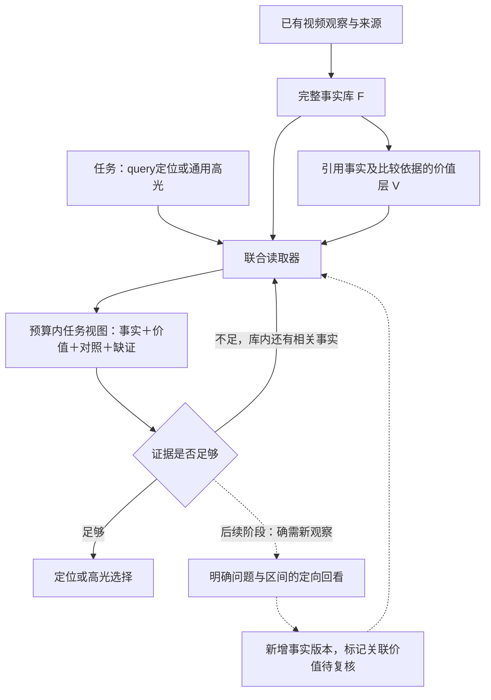

# ReVALUE 事实—价值联合记忆：近期工作对照与下一步设计

> 日期：2026-11-06；版本：`fact_value_memory_design_v1`。本文承接当天的记忆调研、F-read 及详细价值 v4，统一后续架构设计。论文机制、当前实现、拟议改动分别标明；本轮没有启动新的实验模型调用。已有实验继续使用各自冻结版本。

## 1. 设计结论

**以可追溯事实记忆 F 为基础，以引用 F 的价值记忆 V 为判断层，按当前任务联合读取两者。** 价值描述必须带事实依据、比较对象和未知项；读取一条价值时，同时取回它的必要事实，而不是分别截取两段文本后让模型自行补全关联。

- **事实记忆回答：发生了什么、谁参与、在哪些实际观察时刻可见。** 它是模型观察记录，引用合法不等于内容已经人工确认。
- **价值记忆回答：这件事为什么值得观看、相对什么更值得选、还缺什么证据。** 它是可修订的判断，不是高光 GT，也不是固定分数。
- **任务读取回答：为了当前定位或选片，需要哪些事实、价值依据和对照。** 保存范围与本次上下文范围分开，未读入的条目留在完整库中。

这三个职责是本项目的组合设计；相关论文提供部件和设计依据，没有直接验证这一套五维高光记忆。

## 2. 当前已有什么，缺什么

| 部分 | 已核对的实现 | 当前边界 |
|---|---|---|
| 全片事实库 | TVSum 的旧64个采样时刻分为8组；保存事实文本、帧ID、真实PTS、可见性、缺证与来源调用 | 稀疏覆盖；不是完整事件记录。时间跨度不等于事件起止边界 |
| F-read | 在1024 token内保留原时间组与不确定性覆盖，再补候选局部/邻近证据及事件标签覆盖 | 只读取 F；邻近是时间关系，尚未确认同一事件或因果 |
| 详细 V v4 | 五维问题，分别回答 observation / contribution / relative；保存 `source_fact_ids`、`contrast_fact_ids`、理由、缺证及版本 | 代码与对照已冻结，尚不能宣称效果通过；当前价值仍以观察组为单位 |
| F/V关系 | V引用的源事实与比较事实必须来自已提供的F视图；检查ID及源帧重用 | 不能保证描述真实、事件归属正确或两段可公平比较 |
| V读取 | 1024 token内保留正面、未知、负面及有比较依据的记录覆盖，再按组装入 | F先固定，V后装入；还没有双向联合选择 |
| 更新与回看 | 完整库、原响应、来源和旧预测可追溯 | 当前这条TVSum路线没有动态回看、跨组实体表和语义事件图 |

源码依据：F-read（本地资料：`$MERIT_ROOT/experiments/revalue_tvsum_memory_read_v1/memory_reader.py`）、价值契约及装箱（本地资料：`$MERIT_ROOT/experiments/revalue_tvsum_value_detail_v1/value_contract.py`）、[详细价值标准](revalue_generic_highlight_value_v4_2026-11-06.md)。

特别注意：新V写入器的可引用词表由 `facts['fact_ids']` 限定，只包含当前F-read视图。**以后联合读取可以重新取回完整库里的旧事实，但不能凭空补出从未生成的价值记录。** 若要扩大价值写入时可见的事实范围，必须另设写入实验，不能算作只改变读取。

## 3. 近期工作具体借鉴什么

本轮在既有调研上补检截至2026-11-06的公开工作，新增重点是2026年10月的VideoTapestry。以下均核对作者论文的方法章节；不是穷尽检索，也没有复现其论文结果。

| 工作及已读位置 | 论文机制 | 本项目吸收方式与边界 |
|---|---|---|
| [MERIT，2026，§3.3–3.4](https://arxiv.org/html/2608.07663v2#S3.SS3) | 用事件、对白、对象、摘要多键找锚点，再扩展并过滤时间邻域 | 先保留细粒度事实，按任务组织局部证据；无音频时不造对白键。价值维度索引是我们的扩展 |
| [MemDreamer，2026.06 v2，§3](https://arxiv.org/html/2606.07512v2#S3) | 自适应分段与分层事件/实体图；推理阶段用工具读取文本记忆 | 借鉴从概览到事实的导航；近期先做现有条目的索引。它的文本检索不能称为原视频回看 |
| [VideoTapestry，2026.10.05，§3.1–3.3](https://arxiv.org/html/2610.06672v1#S3) | 基于固定层次记忆，按问题观察并细化临时分支，再组合全局上下文和局部细节；基础库不变 | 借鉴“基础库＋任务局部增量”；以后补证保留原版本。当前没有实现其多层Agent和新观察 |
| [LensWalk，2026.03，§3.4](https://arxiv.org/html/2603.24558v1#S3.SS4) | 时间锚点与持续更新的Subject Memory Table维护跨轮实体引用 | 后续增加有来源的主体/事件身份，处理反应归属；不能把相似衣服或相邻时间当作同一人/同次事件 |
| [Aha，2025，§3.2及附录F](https://arxiv.org/html/2509.16421v2#S3.SS2) | 任务文本KV长期保留，视觉上下文使用滑动窗口；分别预测相关性、信息性、不确定性 | 借鉴任务状态持续可见与判断职责分离；它是内部KV及训练路线，不是外部JSON事实库 |
| [VisionReward，§2.1–2.2](https://arxiv.org/html/2412.21059v2#S2) | 将视觉评价拆为细粒度可回答问题，再学习偏好组合 | 为V提供具体问题的设计思路；我们的五维高光标准、unknown和证据依赖是任务适配，不是其官方标准或奖励权重 |

**取舍：先用MERIT的轻量索引和按需组合，保留MemDreamer/VideoTapestry的分层扩展接口。** 两条路线对“建库时预先做多少语义结构”取舍不同，不能把“图越复杂越好”当成文献共识。当前事实数少且存在感知错误，完整图会增加成本及关系错误传播的机会；这是项目侧推断，需验证，不是上述论文之间的受控结论。

## 4. 统一存储：两个内容层，一个任务视图

### 4.1 事实层 F：尽量保留可核对的观察

沿用 `fact_id / text / frame_ids / pts / visibility / missing_evidence / source_call`。新增索引只从已有字段派生，不增加模型推断。`event_family`保持分类标签含义，不能冒充稳定事件ID。

将来确需跨片段关联时，再加入带证据及状态的 `entity_id / episode_id`。缺乏主体或同次事件证据时为空。`before`可来自真实PTS；`causes`、`same_episode`不能从时间先后自动推出。

概览优先是时间组、事实ID、事件标签及可用性索引。语义摘要或语义事件划分如果需要模型生成，单独计成本、保留来源，不包装成免费CPU索引。

### 4.2 价值层 V：保存判断及依赖，不只贴标签

保留已实现的五类：关键结果 outcome、核心信息 information、情绪 emotion、动作 action、视觉事件 sensory。每条记录至少有：

```text
value_id / dimension / rubric_version
observation / contribution / relative
source_fact_ids / contrast_fact_ids
why_watch / missing_evidence / source_call
```

后续版本增加 `scope` 和所依赖的事实版本：区分“通用观看价值”与“针对特定query的价值”，事实修订后能标记受影响判断待复核。关系检查只是保证判断可追溯，不代替语义判断。

- `supported`且`relative=unknown`：有观看理由，但没有证明比其他片段更好。
- `relative=no`：相对当前指定参照不占优，不等于没有高光价值。
- `unknown`：缺证；不能当作负样本或默认为低分。
- 比较要说明对象、维度和可比性；“不同事件”不自动意味着可以比较精彩程度。
- 同类重复、新信息、关键结果与情绪强弱必须引用具体对照，不能用全片没有观察到的内容作结论。

### 4.3 联合读取单位：一条判断及其证据依赖

读取单位从单独F/V条目扩展为：

```text
候选或待查问题
  → 相关事实
  → 价值判断
  → 支持事实 + 比较事实 + 明确缺证
  → 对应原帧与PTS指针
```

例如，V声称“这次反应比前一次更强”，本次上下文必须同时包含两次反应的事实、主体归属状态和时间来源。如果依据装不下，省略该判断或保留缺证，不能只留下“反应更强”结论。共享事实只保留一次，其原始来源仍完整。

## 5. 读取与更新流程



虚线为后续设计，当前TVSum冻结实验不包含这段循环。

**先读库，再决定是否需要新观察。** 区分三种失败：条目已存但未读入；源帧未覆盖所需细节；帧已提供但模型误解。第一种优先改读取；后两种不能靠拼更多文字保证解决。回看目标应是具体可验证问题，例如“球是否过门线”“反应属于哪位人物”，并绑定时间范围和缺证类型。

任务分工保持清楚：

- **QV grounding：** query条件与时间证据决定区间是否成立；价值只能提供辅助证据或检索线索，不能用“更精彩”替代“符合query”。
- **QFVS：** query概念相关性、全片覆盖与集合冗余分别处理；同类比较不能替代漏检检查。
- **TVSum/Mr.HiSum通用高光：** 从全片观察与具体观看理由出发，不从“找高光”这句话捏造对象限制；保留候选之外的全片覆盖。

未来更新采用追加版本：保存新观察、旧判断及失效原因；价值结论不反向写成事实。回看仍失败时可以保持unknown并结束，不以强迫胜负换取表面有效率。

## 6. 下一步怎么验证，避免同时改太多

### 第一步：完成已经冻结的详细价值对照

已有 FV-brief / FV-detail 控制价值写入提示，其余固定。先得到其合法性、依据充分性、相对判断分布和完整40视频结果。本文件不修改这次源码、数据或提示。该实验只能回答细化写入标准的影响，不能代替联合读取实验。

### 第二步：只改变F/V联合读取

在同一份完整F库和同一份V库上，比较现有顺序读取与联合读取；固定原40完整清单、模型、旧帧/PTS、价值条目、任务、选择器、导出和评价。预先指定使用FV-detail库，不能根据两臂成绩临时挑库；失败视频保留，不筛成成功子集。

联合读取器的设计约束：

1. 继续保留全片时间覆盖与不确定性可见性，再按候选/任务证据需要补充，不能只保留模型已认为“有价值”的条目。
2. 选择一条V时，一并检查其全部支持与比较F能否进入上下文；取回共享依赖时去重，任何悬空引用均不可提交给选片器。
3. 保持F≤1024、V≤1024及原总上下文/输出上限。索引、引用和标题也计入预算；不通过新增概览或隐藏上下文提高实际额度。
4. 两臂使用相同字段与呈现规则；由读取变化引起的active引用词表和实际长度差异记录为不可避免的共同变化。
5. 读取优先级、并列处理、失败回退和精确调用/token/GPU预算在运行前单独冻结。本设计不包含新增推理启动许可。

先做CPU可行性检查：引用闭合、依赖成本、全片覆盖、候选之外的覆盖、正/负/未知判断可见性，以及与旧读取是否实际不同。**若在当前预算和V可引用范围内两种视图没有有效差异，就停止这个对照，不为凑实验再调用模型。** 新读法不能补出未生成的V，也不能解决未采到的动作。

效果评价保持完整分母、原生Top-5 mAP、排序/同分敏感性、配对区间及成本；增加按类别和原清单顺序选取的证据案例审计，分别检查事实真实性、比较可比性和价值理由。助手审阅不能算独立人工标签。原40已经用于多次开发，后续改善只能称开发证据，需要新数据确认泛化。

### 第三步：再单独验证写入范围、事件绑定或定向回看

第二步若显示主要缺口来自V从未看到所需事实，再比较扩大V可读事实范围；若是主体/事件归属错误，再比较实体或事件绑定；若是源帧缺证，再设计同成本回看。每次只改变一项，不与新模型、更多帧、价值题库修改一起叠加。

## 7. 本轮交付与证据边界

- 本文是统一架构与后续验证设计；没有宣称已经实现完整事件图、联合读取或Agent回看闭环。
- 本轮核对本地源码和作者论文，新增VideoTapestry作为近期参照；没有运行其代码、训练模型或做跨论文成绩对比。
- 新增实验模型/API请求、实验token、GPU分配、GPU时间、worker和重试均为0；此前已授权后台任务的消耗另计。
- 旧[记忆调研](revalue_memory_mechanism_and_related_work_2026-11-06.md)保留其历史状态；[F-read协议](revalue_tvsum_memory_read_protocol_2026-11-06.md)与[价值v4执行记录](revalue_tvsum_value_detail_execution_2026-11-06.md)保留独立实验含义。

本项目要检验的假设是：**在固定上下文预算下，联合取回价值判断及其事实、比较依据，是否比两层依次装入更可靠地支持定位或高光选择。** 当前文献与结构检查支持这一问题值得测试，尚未证明它会提升指标。
