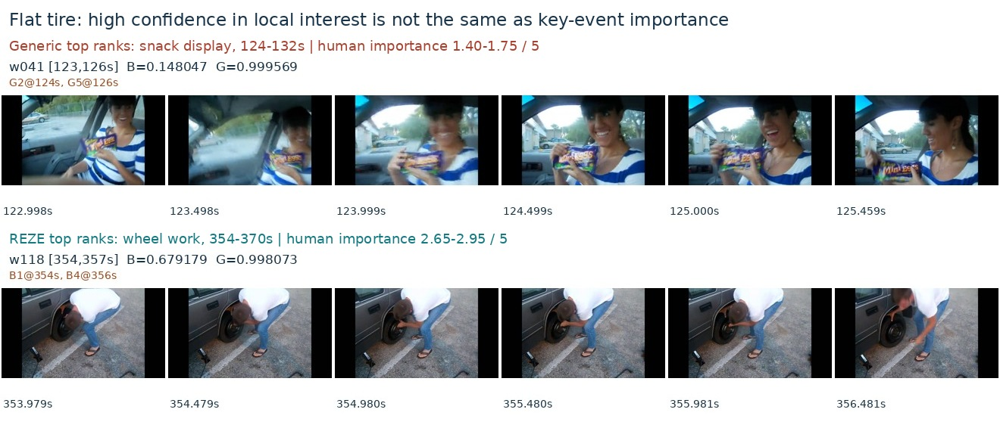

# TVSum 通用高光评分 v1：失败案例与下一步改进

## Material Passport

- Origin Skill: academic-research-suite / experiment-agent
- Origin Mode: validate；附后续实验建议
- Origin Date: 2026-11-10
- Verification Status: ANALYZED
- Version Label: generic_highlight_tvsum_val10_failure_analysis_v1
- 范围：既有10条预测的 CPU 分析及助手原帧审阅。新增实验模型调用、实验 token、GPU 分配均为0；未重跑、未推送。

## 主要判断

当前更值得解决的是**评分目标与高光关键性之间的偏差，以及最高分片段的区分能力**。模型能发现不少有价值的画面，但“有具体观看理由”的范围太宽，一些局部有趣、信息可见的片段超过了视频主要事件的关键时刻。

主指标仍为新方法57.8566、REZE 61.3167，差值−3.4601 pp，5条提升、5条下降；已有配对区间[−19.2607, +12.9474] pp跨零。不能认定新方法普遍劣于 REZE，也不能把这轮解释为五维价值机制整体无效。本次只有一个包含五类可选例子的 Yes/No 判断，没有独立五维评估。

一个新增发现是：**全时间轴的关联变好，前几名却没有选得更好**。新补充的逐视频 Spearman 与人工平均重要性评分相关性在8/10条上提高，均值从0.2952到0.4444；与此同时，Top-5 的人工平均分从2.499降到2.413，按评价中位数规则计的正例判断比例从53.8%降到50.8%。这些是事后描述性诊断，不能替代预定的 Top-5 mAP，也没有据此选择有利子集。

## 审阅方法与已排除项

保留完整10条统计。画面案例按既有 AP 差值选择下降最大的3条和提升最大的2条，仅用于解释已发生的现象。共审阅48个原始评分窗口、288帧，生成11张联系表；重新解码后逐窗口验证模型输入像素哈希和实际 PTS，与原推理一致。不是独立人工标注，未听取音频，也未观看全部连续视频。

两组均为相同模型、相同3秒窗口/2 fps、相同概率读数与时间导出。此前已核对全部1,260窗口输入一致，零解析失败、零缺失概率回退。新条件没有整视频同分；不能用此前四态比较全 tie 的问题解释这次结果。旧 REZE 是缓存对照，仍保留启动调度数值差异的限制。

## 具体案例

### 1. 换轮胎：局部趣味挤掉主要事件

`J0nA4VgnoCo`（标题 `#0001: FLAT TIRE`），AP **70.24→18.54，−51.69 pp**。

- 新 Top-5 中有4个2秒片段位于124–132秒：画面是车内人物笑着展示、拿取零食。人工平均重要性为1.40–1.75/5，每段仅2–4位标注者判为高于其个人中位数。
- REZE 前列集中在354–370秒等换轮胎操作。354–356秒人工平均分2.80、15/20正例；366–368秒2.95、12/20正例。
- 新方法并未把换轮胎判成低分：354–356秒仍有0.996882，366–368秒0.998012，但只排第7和第6；130–132秒零食片段以0.999904排第一。

**支持的诊断**：当前目标允许“局部有趣”替代“对主要事件关键”；更明显的笑容/展示行为可以拿到极高分。**不能证明的部分**：输出只有一个 token，无法确定模型实际使用了情绪、信息或其他哪一条价值线索。主题缺失的因果贡献仍需单变量实验验证。

图中的 B/G 为原3秒窗口分数；正文为评价的2秒分数，两者因边界融合可有差异。标题仅用于事后理解，没有进入任一评分器。

### 2. 跑酷报道：能够识别动作，但前列顺序偏移

`cjibtmSLxQ4`，AP **71.46→41.83，−29.63 pp**。

- REZE 第一名194–196秒是高处撑起身体、接近倒立的动作，人工平均2.45，15/20正例。
- 新第一名478–480秒是人物翻看/展示照片，人工平均1.45，4/20正例；194–196秒降至第5名。
- 新方法也选中了520–524秒的跨越建筑间隙动作，人工平均2.45–2.85。因此不能说整个新 Top-5 都是无关内容。

该视频 Top-5 人工平均分甚至从2.05升到2.20，但 AP下降：问题很大程度在于**把较弱片段放到第一名，并改变了强片段的前列位置**。照片展示可能提供信息，却不能仅凭“有信息”推出它比具体动作更值得保留。

### 3. 火车事故：接近1的分数不能可靠表示关键程度

`sTEELN-vY30`，AP **75.60→56.03，−19.56 pp**。

- REZE 第一名10–12秒是事故现场的俯视画面；人工平均4.35，18/20正例。
- 新方法对此仍给0.999797，却排第7，未进前五。
- 新第二名64–66秒是受访者指向现场的画面，分数0.999904；人工平均1.35，2/20正例。新第一名118–120秒为采访转向车辆现场的镜头，人工平均2.75，13/20正例。

这些画面都与报道相关，但关键程度不同。新方法对该视频32/50个窗口给出≥0.95，很多候选挤在概率上限附近。**这不是浮点数把分数都截成1，也不是已有证据证明的小数差纯属噪声**；问题是这些 Yes 概率差没有被证明能代表人类重要性差。全时间轴相关性0.0521→0.4845，同时 Top-5 AP下降，进一步说明需单独检查最高分片段。

### 4. 提升案例：价值信息有作用，但收益需拆开看

**狗狗护理视频 `Bhxk-O1Y7Ho`：67.75→82.69，+14.94 pp。** 新方法把442–444秒狗狗的展示画面排第一，人工平均3.20、18/20正例，并把118–120秒梳理画面纳入前五。REZE 原第三名16–18秒为人物头部附近摆弄条状物，人工平均1.25、1/20正例。说明仅关注明确动作也会产生偏差，信息/展示型证据可能有帮助；但新 Top-5 平均重要性并未全面上升，不能扩大为稳定收益。

**蜜蜂新闻 `Se3oxnaPsz0`：26.07→77.11，+51.04 pp。** 新方法把52–54秒蜂巢/密集蜂群画面排第一，人工平均3.35、15/20正例；REZE 第一名136–138秒是记者画面转新闻片尾，平均1.60、4/20正例。这支持展示型重要信息被新目标捕获。但新前五其余多为采访画面，完整 Top-5 正例判断数反而从28/100降为21/100，平均重要性1.89→1.77。

这与采用的 UMT 评价实现一致：每位标注者分别二值化、截取前五，在该前五的正例数量上计算召回并积分。因此强正例排第一可能显著提高 AP，即使其余前五不理想。保留官方口径，不借机换掉主指标；后续同时报告 Top-1、Top-5 正例比例及全时间轴相关性，避免把 AP提升等同于所有片段都选得更好。

## 问题的优先级

| 问题 | 证据强度 | 含义 |
|---|---|---|
| “值得看”接受范围比“关键时刻”更宽 | 提示源码直接可见；零食/照片案例支持 | 需要约束与视频主要事件的关系 |
| Yes 置信度直接承担重要性排序 | 实现已确认；事故案例支持 | 确认某价值存在，不等于确认其相对关键程度 |
| 前几名存在较大错误，整体排序未同步恶化 | 完整10条的 AP/相关性诊断已确认 | 优先改高分片段的判断目标，不因AP下降否定所有中低分 |
| 缺少全片主题与事件进程 | 输入契约已确认；因果关系待检验 | 3秒内无法稳定判断某局部趣味是否属于全片核心 |
| 五类示例哪一类造成偏差 | 目前无法确认 | 单 token 无判断理由，不能给维度贡献下结论 |
| 3秒→2秒融合 | 两组相同、权重重算一致 | 可与新分布相互作用，但不是新引入的导出错误 |

整体概率升高不能单独解释 mAP下降，因为一致的单调变换不改变排序。提高最终分数阈值或对最终分数做单调校准，不会修复当前 Top-5。单纯将窗口缩为2秒、扩大模型或添加比较器，也尚无这轮的因果证据支持。现有采样已呈现零食、换胎、照片和动作的区别，不能首先归咎于关键画面完全没采到。

## 下一步建议：先验证主题约束，再调整关键性判断

**第一优先级：增加极简的全片事实背景，验证“主题偏移”假设。**

保留当前完整val10、3秒窗口、原6帧、评分提示、Yes/No读数、导出与评价，仅给每次局部评分附加同一份该视频的事实背景。背景用预先固定、与GT无关的均匀旧帧生成，只描述主要对象、事件和可见进程，不能包含高光位置、重要性分数、旧预测或类别答案。不要直接把本次事后查看的官方标题塞入评分器。背景先冻结；之后所有窗口使用相同版本。这样可检验换胎视频中的零食偏移是否减少，也能看到新闻类问题是否仍存在。这是一个待执行的新条件，需独立计入背景生成和局部评分成本，本轮未运行。

**第二优先级：在统一背景下，单独比较“有观看理由”与“关键进展/结果”的目标。**

一次只替换判断目标，固定背景、帧、输出长度和评分方式。候选目标为：“该片段是否呈现理解主要事件所必需的关键进展、转折、结果或代表性信息？”五类价值作为支持这一判断的证据来源，不是任一维度成立就自动高分；信息展示和事件结果仍可入选，不能退化为只挑大幅动作。允许全否、同分和负结果，不规定每视频必须选出多少个 Yes。

**第三优先级：若主题对齐后前列仍难分，再研究局部核验。**

先确认缺的是动作结果、事件前后文还是语音信息，再定向补看或 ASR；把回看放在证据缺失处。对已有帧已足够描述内容、但价值目标不明确的情况，反复读同样画面不应成为默认修复。额外比较或记忆模块应等上述简单对照有结论后再接入。

下一轮继续完整10条开发对照，不能只跑这几个诊断案例；主指标与新增诊断口径须在开跑前冻结。若开发结果改善，后续验证需另行声明哪些数据已在历史中接触过，不能把旧val10或已看过的其他结果改称独立测试。

## 统计检查与范围

按 ARS validate 清单检查11/11项：Simpson悖论（这里是不同指标，不能混同为分组反转）；生态谬误（不从10视频均值外推单窗口）；选择偏差/Berkson（案例按极值挑选，仅诊断）；collider（未做相关变量条件化）；基率忽略（正例按每位标注者中位数定义）；均值回归（改善案例不作为未来效果保证）；幸存者偏差（完整10条保留）；多重搜索（新增指标仅探索）；分析路径选择（保存全部结果，不替换主指标）；相关不等因果（机制待消融）；反向因果（标签在预测冻结后读取，仍不能由标签反推模型采用的理由）。无新增显著性检验。

## 证据文件

- [原配对结果](revalue_generic_highlight_tvsum_val10_results_2026-11-10.md)
- [全10条片段、分数、人工标注与源窗口](artifacts/revalue_generic_highlight_tvsum_failure_analysis_2026-11-10/analysis.json)
- [描述性指标汇总](artifacts/revalue_generic_highlight_tvsum_failure_analysis_2026-11-10/diagnostic_summary.json)
- [CPU 分析与联系表生成脚本](artifacts/revalue_generic_highlight_tvsum_failure_analysis_2026-11-10/diagnose_failure_cases.py)
- [跑酷画面](artifacts/revalue_generic_highlight_tvsum_failure_analysis_2026-11-10/cjibtmSLxQ4_page1.jpg)、[火车事故画面](artifacts/revalue_generic_highlight_tvsum_failure_analysis_2026-11-10/sTEELN-vY30_page1.jpg)、[蜜蜂新闻画面](artifacts/revalue_generic_highlight_tvsum_failure_analysis_2026-11-10/Se3oxnaPsz0_page1.jpg)、[狗狗护理画面](artifacts/revalue_generic_highlight_tvsum_failure_analysis_2026-11-10/Bhxk-O1Y7Ho_page2.jpg)
- UMT 评价源码（本地资料：`$MERIT_ROOT/experiments/revalue_generic_highlight_scoring_v1/vendor/umt_tvsum.py`）、两种提示源码（本地资料：`$MERIT_ROOT/experiments/revalue_generic_highlight_scoring_v1/prompts.py`）

原 manifest、预测、预测冻结收据及 GPU 结束收据在分析前后哈希相同；脚本断言验证了全部前五片段的时间融合权重，所有审阅窗口像素哈希与PTS匹配，Ruff通过。源视频、预测和冻结实验源码均未修改。
