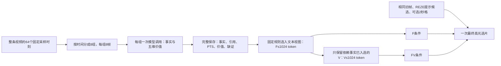

# ReVALUE 当前记忆机制与相关工作调研

## Material Passport

- Origin Skill / Mode：academic-research-suite / deep-research，定向机制调研与本地实现核对。
- 日期：2026-11-06；版本：`revalue_memory_review_v1`。
- Verification Status：当前机制经源码与既有产物核对；论文机制按下文所列阅读深度核查；改进建议尚未实验验证。本报告不是系统综述，也不是相关论文的复现结果。
- 用户请求：说明当前记忆机制、核查已有借鉴，并调研近期长视频理解及高光检测中的记忆设计。
- 本轮新增实验模型/API调用、实验token、GPU分配、GPU秒、实验worker、重试均为0。网页检索与当前助手分析不计作实验推理。保留旧协议、源码快照、预测与账本，不推送。

## 1. 先回答：有参考，但只实现了其中一部分

**当前TVSum主线是一套“全片稀疏观察 → 可追溯事实与价值条目 → 固定长度文本视图 → 看图选片”的静态外部记忆。** 它具备来源追溯和事实/价值分层，但尚无按任务检索、语义层次图、跨片段实体跟踪和回看更新。

需要区分三个阶段：

| 阶段 | 已有依据与实际实现 | 不能混同的部分 |
|---|---|---|
| 早期MERIT在QV上的适配 | 10秒片段描述，事件/对象/摘要三键向量检索，时间邻域扩展，逐轮筛选证据 | 这套检索在旧分支实际存在，不能说项目从未做过检索；它未被直接接入当前TVSum F/FV实验 |
| 较早QV ReVALUE候选验证 | 围绕Direct/REZE提出的区间生成事实、Query条件和价值判断 | 候选验证的局部事实不等于全片记忆；不能套用它描述当前TVSum建库范围 |
| 当前TVSum F/FV主线 | 全片64个稀疏采样时刻分组建库，事实F和附加价值V组成选片上下文 | 全片稀疏覆盖不等于完整记录所有事件，也不等于MERIT或MemDreamer的检索系统 |

[11月4日方案第5.1节](revalue_next_experiment_plan_2026-11-04.md#L89)已经明确引用MemDreamer，并说明第一版只取“可追溯节点、时间索引、记忆与推理分离”，将完整层次图、向量检索和多步工具留待后续。因此不能说当前设计没有文献依据，也不能把设计借鉴称为完整实现。旧分支见[MERIT适配文档](merit_qvhighlights_adaptation.md)和[检索执行代码](../src/merit_qvh/pipeline.py)。

此前[价值判断相关工作报告](revalue_value_verification_related_work_2026-10-31.md)讨论了VisionReward、UnifiedReward-Flex、HIVE、DSG等。它们主要支持价值判据、事实依赖和验证设计；不能据此宣称当前已经采用了专门的高光记忆读写算法。

## 2. 当前机制具体怎样工作

### 2.1 写入：全片分组观察，不是只看Top-5

- 建库使用全片64个固定采样时刻，按时间顺序分成8组，每组8帧；当前27B路线每组一次调用。组与组之间没有持续的模型内部会话状态。
- 每组同时生成事实F与五种价值V。提示要求至多2条简短事实，schema允许最多3条；五维为结果`outcome`、信息`information`、情绪`emotion`、动作`action`、视觉显著性`sensory`。
- 事实保存`frame_ids / event_family / text / visibility / missing_evidence`；程序补充稳定ID、真实PTS和`source_call`。价值保存`dimension / state / source_fact_ids / why_watch / missing_evidence`。
- 价值是每个观察组的五维记录，不是每一条事实都有完整五维标签。`supported`必须引用本次观察中清楚的事实；`unknown`保留缺少什么证据；`not_applicable`允许该维度不适用。
- 本版实际没有`contrast_fact_ids`，也没有可靠的跨组人物ID。方案里提出过这些内容，不代表已实现。

例如库中的“片头出现Beekeeping 101文字”是一条带帧ID与PTS的模型观察；它可以支持“视频主题的文字线索”，却不能仅凭字段合法就证明“片头比养蜂操作更值得入选”。事实的来源、事实是否真实、相对高光价值，是三个不同问题。

### 2.2 存储：完整库和给模型看的视图分开

完整bank保留所有生成条目。程序还按时间生成先后或观察时间重叠关系，但明确标记为`PTS_only_not_causal_or_event_identity`：**时间相邻不证明同一事件，更不证明因果。** `event_family`是短标签，不是稳定事件跟踪；事实最早/最晚PTS也不是经过定位的事件边界。

因此当前存在“可追溯观察表”，尚不存在“传球→射门→进球→观众反应”的已核验语义事件图。

### 2.3 读取：固定装入条目，还没有按任务检索

F的输入视图最多1024个模型原生token：先保留每个非空组第一条事实，并尽量保证不确定事实可见，再按组轮流装入其余完整条目。V也最多1024 token，但只有引用事实全部进入F的价值才具备入选资格，然后按固定顺序装入。

这一策略兼顾了时间覆盖和来源完整性，但不判断“当前需要哪个事实”。**事实没进入输入视图，不代表从库里删除了；后续可以从旧bank重新读取，不必自动重建库。** 同时，排在组内较后的关键结果可能没有机会进入模型上下文，必须实验检验这种读取策略是否合适。

### 2.4 使用：附加文本后，模型仍看原来的图

最终选片仍输入相同的64张全片采样图及去重后的旧候选图，总数最多84张，还包括REZE Top-5提示、预先绑定帧来源的2秒格选择表、相同的高光任务与相对价值规则。

- D-relative：只有上述共同输入，没有文本记忆。
- F-relative：共同输入 + F。
- FV-relative：共同输入 + 同一份F + V。

三者都是一次最终选片；当前没有检索工具调用、证据不足后新增采帧、慢放或记忆修订。F/FV共享每视频8次建库，再各做1次选片；D只需1次选片。因此本轮测试的是**额外结构化观察是否帮助选片**，尚未证明记忆能够节省看图成本。F本身来自同时要求价值字段的建库调用，也不等于完全不受价值提示影响的独立事实描述器。

实现依据：当前共同提示（本地资料：`$MERIT_ROOT/experiments/revalue_tvsum_overnight_v1/prompts.py:34`）、视图构造（本地资料：`$MERIT_ROOT/experiments/revalue_tvsum_overnight_v1/contract.py:464`）。F/FV实跑以`$ZEROSHOT_ARTIFACT_ROOT/revalue_tvsum_relative_full50_27b_v1_2026-11-05/source_snapshot/`中的冻结代码为准。

## 3. 近期长视频理解：有哪些可借鉴的记忆机制

下列按机制而非论文成绩比较；长视频问答的提升不直接证明高光选择会提升。时间按所查论文版本标记。

| 工作与来源 | 记忆如何写、读、更新 | 与当前机制的差距／借鉴价值 |
|---|---|---|
| [MERIT，2026.08](https://arxiv.org/html/2608.07663v2) | 为片段描述建立事件、对白、对象、摘要等多种检索键；取语义匹配锚点后扩展邻近描述，再筛选相关证据，可迭代改写检索问题 | 可恢复“库保存广、读取有目标”的路径。邻域扩展首先是读已有描述，不等于回放原视频；任务相关也不等于高光价值高 |
| [MemDreamer，2026.06 v2](https://arxiv.org/html/2606.07512v2) | 自适应事件划分；局部实体/微事件子图向上形成宏事件、超级事件和全片概览；推理器通过层次导航、节点搜索、时间搜索与图遍历读取文本记忆 | 当前只实现了节点来源与时间索引。可先做概览到局部证据的读取；不要把PTS顺序伪装成因果边 |
| [VideoARM，2025.12](https://arxiv.org/html/2512.12360v1) | Sensory Memory保存视觉观察，Result Memory保存带时间范围的工具结果，Working Memory承载当前任务状态；动作执行后继续更新 | 提醒我们区分事实库、已有检查结果、下一步待查问题。现版没有这种在线更新循环 |
| [LensWalk，2026.03](https://arxiv.org/html/2603.24558v1) | 全局Subject Memory Table持续维护实体属性与出现时间；配合宽范围扫描、局部密看和跨区间联合核查 | 对“这个反应属于谁”“前后是否同一个人/事件”有针对性。当前`event_family`不能替代实体表 |
| [WorldMM，2026.03 v2](https://arxiv.org/html/2512.02425v2) | 结合多时间尺度事件记忆、整合后的语义记忆和可回取的视觉记忆，按问题选择记忆类型并检索 | 借鉴“文本用于定位，原始视觉证据可回取”的分工；不能只靠文字越来越长来保存细节 |
| [PReM，2026.09](https://arxiv.org/html/2609.23601v1) | 查询无关的循环写入器维护固定大小、多槽关联状态；回答时按问题读取，并对既有前缀的K/V进行调制 | 属于模型内部接口改造：主干冻结，但新增读写模块需要训练。不能通过加一段提示直接接入当前服务，近期工程优先级较低 |

前五篇核对了方法相关章节；PReM核对了第3节及训练接口说明。它们共同提示：有价值的记忆系统通常明确规定**何时写入、保留什么、当前读哪部分、何时更新**；仅有可读的文本记录还不足以完成这些功能。

## 4. 高光检测／视频摘要领域是否有专门记忆

**有，但不能把论文中所有“memory”都理解成我们的JSON事实库。** 至少需要区分外部事件记忆、可训练特征记忆和Transformer内部KV缓存。

| 工作与来源 | 实际机制 | 对本项目的含义与限制 |
|---|---|---|
| [Aha，NeurIPS 2025，在线高光检测](https://arxiv.org/html/2509.16421v2) | Dynamic SinkCache持续保留任务目标文本的KV，滑动窗口保留近期视觉上下文；系统联合判断相关性、信息性与不确定性 | 是直接相关的高光记忆工作，但“长期记忆”主要保任务目标，不是保存所有关键事件。整体系统包含训练，不能直接拿其指标与本项目零样本结果比较；也不能把缓存方法本身说成必须训练 |
| [Query-Focused Video Summarization，CVPR 2017](https://arxiv.org/pdf/1707.04960) | 用可训练memory network将query与视频帧/shot关联，再由顺序DPP选择摘要集合 | 这是经典来源，不冒充最新工作。提醒我们同时处理相关性和集合冗余，不能只给每条记忆独立贴价值标签 |
| [CGMT：Query-focused video summarization driven by sentences，Displays 2026](https://doi.org/10.1016/j.displa.2026.103398) | 作者摘要/引言描述以CLIP特征、全局记忆Transformer及文本引导注意力完成特征融合和选片 | 属于特征级、可训练路线。本轮仅核对出版信息、摘要/引言级材料，未验证完整实现或训练细节，不列为立即可复现首选 |

Aha另核对了[官方代码中的SinkCache实现](https://github.com/aiden200/Aha-/blob/41473169504ae3793811066ffd398bc69094e499/test/sink_cache.py)：缓存更新确实保留sink部分并滚动近期KV。但仅凭这个类不能确认论文全部Dynamic SinkCache策略和全部成绩已可复现，仍需连同调用方配置审查。

对TVSum还要注意：它不是“找出符合具体自然语言query的全部时刻”。通用高光目标本身不提供充分的语义检索词；直接将MERIT的query相似度替换成“精彩片段”相似度，未必能识别结果、转折与全片相对重要性。这是任务差异，需要单独验证。

## 5. 当前结果说明了什么

最近新增40视频、同模型同旧帧同任务的比较为：

| 条件 | 原生Top-5 mAP（%） |
|---|---:|
| D-relative，无文本记忆 | 54.9161 |
| F-relative，事实记忆 | 52.6220 |
| FV-relative，事实与价值记忆 | 50.6473 |

这些结果支持“当前额外文本记忆没有带来平均收益”；不能推出“长视频记忆机制没有价值”。F−D还包含额外分组感知、文本长度与注意力分配的变化；FV−F也不是完全排除了长度影响的纯价值概念实验。没有据此确认显著负效应。

既有全new40审计还显示：

- 735条保存的事实中，445条进入F输入。
- 678条` supported `价值中，335条进入V输入。
- 未进入的343条supported中，341条由于依赖事实未进入F，只有2条由于V自己的token上限。
- 实际V缺少比较对象与比较事实ID；`supported`只说明存在模型认可的价值线索，不等于已证明相对重要性。

因此，**固定读取规则限制证据进入上下文**是可复现事实；“它导致掉分”“价值文本造成注意力干扰”“片头被过度奖励”目前仍是待检验解释。删除NA或加长价值描述不能被当成已证明的修复。

来源：[全50离线分析](revalue_tvsum_full50_analysis_and_next_plan_2026-11-06.md)、[夜间D-relative对照结果](revalue_tvsum_overnight_results_2026-11-06.md)。本报告复用这些分析，没有重算评价或重新审阅视频。

## 6. 建议如何借鉴，先改哪一部分

### 6.1 优先验证“怎么读”，复用已有完整bank

先将旧固定读取作为基线，设计同样1024 token预算下的另一种事实读取规则。保持模型、旧帧、选择任务、建库结果和导出一致，不同时重写价值、换模型、加回看。

读取应明确保证时间/事件覆盖，并根据当前候选或待判断问题取相邻事实，避免只因一条事实排在组内第二条就被挤掉。每视频现有条目很少，先用透明的事件/时间索引即可，未必需要向量数据库；如果引入模型检索或新embedding，要单列为新的调用与干预，而不能算“免费CPU重排”。具体规则应在下一轮看成绩前冻结，不能按GT或本次跌幅挑条目。

这是由现有结果推导出的优先建议，不是已经证明有效的方法。当前40视频已查看结果，后续只能作为开发分析；不能改完同一批样本便宣称泛化提升。

### 6.2 再把价值改成“有比较对象的证据”

只有事实读取具备可用性之后，再单独验证价值层。可考虑在原`source_fact_ids`之外引入参照事件/事实及有依据的差异，例如“第二次射门完成进球，第一次未观察到结果”。允许unknown，不强迫每个事件有对手或胜负。

这里可借鉴MERIT的事件及邻域检索、LensWalk的主体一致性，以及摘要选择中的冗余控制；但“五维价值 + 比较证据”是本项目拟议的组合，并非这些论文已经验证了同一方案。

### 6.3 面向更长视频再接入动态观察

长视频扩展可以采用“全片概览 → 事件索引 → 局部事实 → 原帧”的多层读取；当缺少明确结果或主体归属证据时，再调用定向观察，并将新证据写回。事实、模型判断和待查问题分别存储，保留版本与来源，不把后来的推测覆盖成历史观察。

这对应MemDreamer/WorldMM的分层与多模态读取，以及VideoARM/LensWalk的在线更新思路。当前不应一次加入完整图、实体跟踪、回看和价值比较，否则无法识别改进来自哪里。Aha/PReM等KV或可训练记忆路线暂作后续模型级选择。

## 7. 调研范围与交付边界

- 检索时间截至2026-11-06；本轮为针对问题的机制调研，重点覆盖2025—2026并补充直接相关经典工作，不声称检索穷尽或系统综述。
- 优先使用作者论文、会议/出版方页面和官方仓库。论文机制核对不等于复现或确认性能；本轮未下载权重、安装环境、运行上述论文代码。
- MemDreamer项目页公开给出了仓库链接，但本轮GitHub连接器读取该仓库README返回404；不据此断言代码不存在，也不把它记作已审查源码。
- 本轮只新增此报告与研究来源/本地哈希收据。所有后续实现与实验仍是建议；本报告不自动扩展此前实验范围。

审计包：memory_mechanism_review_2026-11-06（本地资料：`$MERIT_ROOT/comparisons/memory_mechanism_review_2026-11-06`）。
