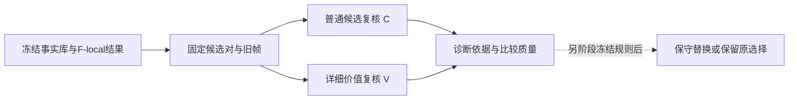

## Material Passport

- Origin Skill / Mode：academic-research-suite / experiment-agent，validate + plan，当前会话内完成。
- 日期／版本：2026-11-07，v1；结果截至北京时间20:56完成的TVSum40事实模块实验。
- Verification Status：已有结果与CPU来源核查 **ANALYZED**；新方案 **UNVERIFIED**，未重跑模型验证。
- 本轮范围：整理结果、审查机制、提出下一步设计；新增实验请求、实验token、GPU分配、GPU秒、worker、重试均为0。
- `execution_authorized=false`：下述新实验是建议，尚未启动；其候选清单、提示、运行器仍需准备和冻结。

# ReVALUE 当前实验结果分析与下一步方案

## 1. 当前判断

**优先保留新的事实模块，把下一轮问题收敛为：在固定候选及视觉证据下，候选级价值核验能否比普通复核更可靠地支持选片。** 不宜立即重建更多价值库或同时扩展多个数据集。

目前有三个不同层次的结论：

1. **已观察到的结果：** TVSum40上，F-local比旧F高3.10个百分点，与D-1fps的均值差距从4.00缩到0.89个百分点；配对区间跨0，不能称为已确认的稳定提升或与D等效。
2. **已核实的机制：** 同一文字预算装入了更多事实，直接引用按真实时间约束；但许多被选片段仍缺少局部文字事实，价值记录也普遍缺少比较依据。
3. **待检验的假设：** 将价值判断从“按时间组预先写描述”转到“核查具体候选的观看理由及对照证据”，可能比继续堆叠全局V文本更合适。旧QV verifier没有证明该假设在通用高光上成立。

本方案承接11月3日会议纪要（本地资料：`$WORKSPACE_PARENT/.codex/attachments/3858eaca-fb4a-4ac7-a216-1d943277dd18/2026.11.3 会议纪要.md`）的近期目标：先验证高光价值与记忆，再考虑多需求剪辑及完整Agent工具链。QV的query定位、QFVS的查询摘要、TVSum的通用高光须保持任务与指标分开。

## 2. TVSum：最近几轮到底得到了什么

### 2.1 同一固定40视频的最新对照

主指标为现有UMT口径的原生Top-5 mAP（%），不是摘要F1。40条均已用于开发和分析；“前10／后30”是这40条内部的历史分层，不是新的未见测试划分，也不是早期全50实验的official val10。

| 条件 | 含义 | 完整40 | 历史前10 | 历史后30 |
|---|---|---:|---:|---:|
| D-1fps | 最终选择直接读取密集旧帧，无文字记忆 | **58.4767** | 69.2479 | 54.8863 |
| 旧F | 1fps建库，旧事实写入与读取 | 54.4796 | 57.3875 | 53.5103 |
| 旧FV | 旧F＋详细价值记忆，原读取 | 53.2167 | 54.4566 | 52.8034 |
| FV-read | 同一旧事实／价值库，修复V读取分配 | 55.3426 | 56.0212 | 55.1164 |
| **F-local** | 局部原子事实、紧凑读取、逐片段引用绑定 | **57.5828** | 56.6465 | **57.8949** |
| FV-local | 新事实＋原详细价值标准及修复后的V读取 | 56.3439 | 59.7007 | 55.2250 |

F-local和FV-local最新一轮720/720请求完成，两个worker退出，零重试、零输出截断。两臂各40条输出合法，但F-local含1条合法弃权，按原规则回退B0；合法率不是高光准确率。

| 配对比较，完整40 | 差值pp | 95%视频配对bootstrap区间 | 升／降／平 |
|---|---:|---|---|
| F-local − 旧F | +3.1032 | [−1.1440, +7.7236] | 19／19／2 |
| FV-local − FV-read | +1.0013 | [−3.4171, +5.5338] | 20／19／1 |
| F-local − D-1fps | −0.8939 | [−5.3069, +3.7727] | 14／23／3 |
| FV-local − F-local | −1.2389 | [−4.9882, +2.5197] | 20／17／3 |

这些区间均跨0。F-local相对旧F的提升与下降视频数相同，均值不能解释为“多数视频改善”。FV-local在前10优于F-local、后30低于F-local，也不支持统一的价值收益结论。

保留模型排序的CPU敏感性导出下，D／F-local／FV-local分别为58.0714／58.1786／56.4520；F-local−D变为+0.1072pp，区间仍跨0。**原生导出为主，不能切换到更有利的导出宣称超过D。**

两个比较限制必须保留：

- D也使用详细的五维高光选择标准，并非“不判断价值”；它只是没有预先生成的文字记忆。
- D最终读取全部密集帧，F/FV最终读取旧稀疏选择帧与文字。二者是不同上下文成本的系统比较，不是同视觉token条件的纯记忆消融。总成本还须计入建库。

依据：[最新结果](revalue_tvsum_fact_local_40v_results_2026-11-07.md)、[执行与固定条件](revalue_tvsum_fact_local_40v_execution_2026-11-07.md)、[旧V读取诊断](revalue_tvsum_value_read_40v_diagnosis_2026-11-07.md)。

### 2.2 不要将不同版本混为一轮

早期稀疏记忆的全50汇总已完成：F-relative 54.0501、FV-relative 53.1028。原val10复用，另外40条是原official train上的零样本开发实验，不能称官方test50。后续稀疏F读取对照在这40条上从52.6220到54.4187，区间跨0。现在的1fps F-local40是新版本，不能把不同采样、提示和阶段的均值差简单归因于1fps。

详细价值提示的原40视频计划曾由用户改为1fps、先10条；中止前实际尝试110次，两臂各只完成6条选择，另外34条使用B0回退。其全分母detail−brief为−0.9020pp，不能将该部分运行误写为完整40条提示消融，也不能据此确认提示细化有效或无效。见[部分运行与完整分母报告](revalue_tvsum_value_detail_results_2026-11-06.md)。当前有详细价值模块的组合实验，尚未确认“提示细化本身”的贡献。

## 3. 事实、价值和输出三个环节的瓶颈

### 3.1 事实容量改善了，但1fps观察不等于密集文字记忆

旧版762条事实、读入428条；新版1254条、读入803条。F文本平均1008.75 token，仍不超过1024；新增的是预算内保留的信息。事实模块同时改变写入规则、容量利用及直接引用绑定，因此不能单独归因于某一句提示或时间约束。

本轮新增CPU核查沿用冻结的“所有源PTS位于2秒片段±0.5秒”规则，得到：

| 局部事实可用性 | F-local | FV-local |
|---|---:|---:|
| 模型原始选片建议数 | 195 | 200 |
| 读入F中有可直接引用的局部事实 | 82（42.1%） | 85（42.5%） |
| 完整F库中有局部事实 | 91 | 91 |
| 实际直接引用局部事实 | 54 | 53 |
| 已读入局部事实但未直接引用 | 28 | 32 |

F-local的113个“当前上下文没有局部事实”的建议中，**104个在完整库中也没有，9个是库里有但未读入**。这支持优先区分写入覆盖和读取遗漏，不支持只靠换读取器解决全部问题。

全40共4387个2秒格，其中3492个在旧choice表可选。完整库为其中768个提供符合该严格时间规则的局部事实；当前F视图覆盖497个。803条已读事实中322条只能作为上下文，不能直接引用到现有候选格。

这些是**机械可用性**，不是语义正确率：没有局部文字事实仍可看局部图像，有事实不代表事实真实，空引用也不能证明模型未使用背景记忆。不应放宽时间规则来制造覆盖改善。引用按原始逐pick统计，避免将并列组的合并引用错误分摊给每个片段。

### 3.2 价值定义已经细化，当前缺口更可能在证据和决策对象

当前五维为结果、信息、情绪、动作、感官事件，每维已有 observation／contribution／relative 三层问题、支持证据、反证、unknown条件及禁止推断说明；不是只有五个空标签。

新版1600条价值记录的relative状态为：**unknown 1385（86.6%）、na 213、yes 2、no 0**。旧库为unknown 1279、na 313、yes 8。事实数量增加没有同步增加明确的相对优先证据；两版事实不同，不能据此断言模型比较能力退化。

已确认的结构限制是：V按8个观察组写入，可引用事实限于当时的F视图，最终选择又面向具体2秒候选。组级“这里有信息／动作”不必然说明“这个候选比另一个更值得选”。例如已存`WxtbjNsCQ8A`记录把片头标题判为有信息贡献，但relative为unknown，理由是没有其他标题时刻作为参照；这证明模型输出了局部观看理由，没有证明它优于养蜂过程。

**假设H1：** 缺少明确、可比的候选及双方视觉证据，使relative长期停在unknown。**假设H2：** 部分价值描述重复了事实，却影响了注意力及排序。二者尚不能由计数确定；也不能把unknown当作负样本，或强迫胜负来解决。

### 3.3 输出传递与事实真实性还未完成验收

时间引用合法不等于动作、物体、因果或事件归属正确。此前助手查看旧帧发现过“跑酷被写成滑板”“片外动作被用于解释当前候选”等支持性案例，尚无独立人工语义标签。新事实是否修复这些语义错误仍需按预先固定案例审阅。

六个冻结案例及F→F-local的AP变化如下；它们按原清单选取，不是挑最大的收益视频：

| 视频 | 旧F → F-local | 本次可以说什么 |
|---|---:|---|
| WxtbjNsCQ8A | 61.42 → 58.22 | 指标下降；选片含片头／文字内容，不能仅凭理由认定更有价值 |
| GsAD1KT1xo8 | 31.66 → 52.82 | 指标上升；是否修复旧动作身份错误待核对旧帧 |
| i3wAGJaaktw | 42.93 → 30.64 | 指标下降；新的时间约束没有自动解决选片问题 |
| VuWGsYPqAX8 | 20.26 → 78.93 | 大幅上升；尚不能归因于某条事实修复 |
| 4wU_LUjG5Ic | 35.22 → 71.81 | 大幅上升；需核对建议与最终导出是否一致 |
| WG0MBPpPC6I | 51.10 → 55.01 | 小幅上升；不能据此证明相对价值判据有效 |

另列弃权例`98MoyGZKHXc`：F-local的68.3958来自B0回退，不是模型成功选片。原生分数导出的并列还可能改变最终Top-5集合，应在任何verifier试验中核对“核查的候选”是否真是评价使用的候选。

## 4. 其他数据集提供的证据

| 数据／版本 | 结果 | 当前能支持的结论 |
|---|---|---|
| QFVS固定40查询，4视频各10条，稀疏F读取 | Oracle F1：Uniform 47.7199、D 43.7665、F 43.3331、F-read 43.5179 | F-read−F仅+0.1848pp，视频整群区间跨0；没有验证V或完整长视频检索 |
| Mr.HiSum固定40视频，稀疏F读取 | D/F/F-read的mAP50为59.5961/59.4063/59.0989；F1为46.0845/47.1429/45.8208 | F-read三项主次指标均无稳定改善；不是1fps或详细V对照 |
| QV100，旧8B verifier v2.4，139候选 | Q/Q+V合法136/137；报警7/10；代理TP 6/8、FP 1/2，recall 7.06%/9.41% | 技术有效率改善；价值核查未证明稳定语义收益，也未改写定位结果 |

QFVS的Uniform来自全片网格，而新模型受84候选池约束；4个源视频不能当40个独立视频。Mr.HiSum有60/190个F-read建议完全不进入最终KTS摘要，Constant F1=56.0692涉及恒定分数与背包选择，**不是均匀时间选片更懂视频**。QV的IoU错误只是筛查代理；“符合query”“区间边界准确”“更值得观看”是不同判断。

依据：[QFVS](revalue_qfvs_memory_read_results_2026-11-06.md)、[Mr.HiSum结果](revalue_mrhisum_memory_read_results_2026-11-06.md)、[Mr.HiSum诊断](revalue_mrhisum_memory_diagnosis_2026-11-07.md)、[QV verifier](revalue_value_qvqv100_v2_4_results_2026-11-02.md)。

## 5. 下一步：先验证候选级价值核查，再决定是否修正结果

### 第一步：完成固定案例审计，零模型调用

保留当前F-local、FV-local、D及完整事实／价值库。复用上述六案例，每个案例审阅全部原始建议和直接证据，依次记录：源帧是否有动作、事实是否忠实、是否属于本时刻、观看理由是否成立、比较对象是否可比、最终导出是否保留建议。

本轮已完成全40的局部可用性CPU核查与六案例来源索引，**没有完成新的逐图语义审阅**。后续仅查看已有图片，不重新解码视频；助手判断标为助手审阅，不能充当独立人工标签。对重要争议保留unknown，建议人工盲审，不依据GT改写事实。

分流规则：库有未读优先审查读取；库无但帧有说明写入覆盖不足；帧本身无证据则不能靠提示补造；证据充分仍误判才主要考察核验器。先避免把四类失败统称为价值问题。

### 第二步：固定10条，比较普通复核与详细价值复核

建议使用原40顺序的前10条，完整保留，无GT筛选。该子集已见，仅作机制诊断。**底座固定F-local；D仍是系统参照，暂不同时换底座。**

| 条件 | 处理 | 用途 |
|---|---|---|
| B | 冻结F-local最终分数和选择，无新调用 | 观察额外核查的改变 |
| C-verify | 候选级通用核查：事件依据、具体观看贡献、相对指定候选的依据 | 控制多一次复核与局部聚焦的作用 |
| V-verify | 与C同输入／输出任务，加原五维详细问题及正反证说明 | 主比较V−C，测试详细价值标准的增量 |

C仍需判断相同的高光任务，不能只让C识别人／物、却让V解决更完整的任务。两臂共享输出schema，均允许支持、反证、不足、并列／不可比；V不必每段五维全成立。提示长度和注意力分配变化是已声明干预，不能称为抽象“价值概念”的纯因果效应。

**候选和证据准备规则：**

- 锚点从冻结F-local分数按原生排序取实际Top-5，不能默认等于raw picks。原始理由只在clip ID一致时附上，否则标记没有原模型理由；空选片／回退单独注明。
- 每视频最多5个替代候选：在原choice表内，按冻结B0分数排序，排除锚点，取前5；同分按clip ID。锚点按其原顺序与替代候选逐一配对，不按GT、已有AP或语义检出难度挑对。第一轮不引入D的选择作为新候选来源。
- 每对两臂使用完全相同的旧帧像素、PTS、呈现顺序和事实。每片最多6张：先时间顺序取片内最早的4张，再在片前／片后各2秒范围内各取最近一张；缺少则保留缺口，不新采样。上下文帧不能当片内动作的直接证据。
- 局部F从同一冻结完整库确定性读取；先直接局部事实，再按时间距离补上下文，总计≤1024 token，双方平衡分配。与原选片的全局F视图不同，C/V共同承担此变化。每条保留源PTS；对应图片不在当前输入的事实标为text-only context，不能冒充本次已视觉查证。不给任一臂旧V结论，避免把待核验结论当证据。
- 每对一次调用，约10视频×5对×2臂=100次。两臂原模型revision、BF16/TP4、temperature=0、seed=0、图像处理和输出上限一致；顺序按固定哈希平衡。冻结全部候选、图像、事实、提示和schema之后才运行。

**输出须将两件事分开：**

```text
候选事实／选择理由：supported | contradicted | insufficient
指定A/B相对优先：A | B | tie | insufficient | incomparable
依据：片内frame_id、fact_id、对照片段ID、具体差异、缺证原因
```

事实被反证不等于该片段完全没有价值；事实成立也不等于应排第一。某维NA不参与否决；缺失音频时不能从口型推断讲话信息量。先不加入ASR、ROI、新回看或事件图。



第一轮只新增诊断输出，**不把报警数量或少输出unknown当成精度提升**。固定候选之外的遗漏仍无法由该verifier直接找回。

### 第三步：验收后再接结果修正，冻结后扩展其余30条

如需检验最终mAP，必须提前单独冻结修正规则：仅当替代候选有双方可追溯证据、可比且明确更优时，允许在对应位置替换；tie、insufficient、incomparable、invalid均保留原结果。不因某片“没检出价值”直接删除，不重估时间边界。原始和派生分数分文件保存。

这是一项新的后处理设计，尚未实现。其导出必须先通过CPU“零修改精确复现B”与“实际Top-5等于约定替换结果”检查；不能直接套用已有可能改变并列的tier导出。如果暂不能满足两者，维持诊断用途，不生成虚假的改善结果。

先在10条诊断中检查能否形成可靠、非强迫的比较，再由用户决定是否执行剩余30条。若扩展，提示、候选规则和修正器全部冻结，合并报告完整40；不得根据10条AP挑规则。40仍为开发证据，不能将既有50中的任一已查看部分包装成新holdout。

### 评价与停止标准

- **技术门槛：** 两臂均至少95%合法；所有被接受引用满足来源与时间契约；无输入漂移。非法、缺失、OOM、弃权分别保留，零自动重试。
- **语义审计：** 区分真实可见事实、理由成立、比较可比性和偏好；先审阅图像再看GT／方法标签。只有助手审阅时明确证据级别，不宣称语义准确率已经验证。
- **偏好诊断：** 冻结输出后，用原20位标注者逐人评价配对偏好一致性、错误偏好和保留率；标注分歧、并列和no-decision单列。少出unknown不是目标，零有效比较也不能通过科学验收。
- **最终效果：** 接修正器后才报告完整分母Top-5 mAP、V−C及C−B视频配对差、误修正／有益修正、native与排序／同分敏感性、含建库和追加调用的成本。所有状态均保留，不能只报两臂都成功的有利子集。
- **规模边界：** 10条是可行性诊断，未做确认性检验的样本量功效设计；不能凭小样本均值宣称获益。40条主要比较固定V−C；次比较完整披露，区间跨0则保持未确认。若始终缺乏比较依据，停止同类提示迭代，回到缺证来源，不强迫胜负。

### 建议资源与尚缺的准备

下表仅为下一轮建议上限，**不是本轮运行许可，也不是已完成的上下文可行性检查**。

| 项目 | 首轮建议 |
|---|---|
| 范围 | 原40的前10；最多50个固定候选对，两臂各一次 |
| 请求／故障重试 | 最多100次总尝试；失败也占槽位；重试0 |
| 模型与并行 | 保留27B及原revision；最多2个TP4 worker，只使用届时空闲GPU |
| 每次输入与输出 | 总token上限16384，输出≤1536，事实视图≤1024；C/V相同 |
| 绝对token建议上限 | 1,638,400；实际prompt、schema、图片开销须CPU实测后冻结 |
| 生命周期建议上限 | 每worker≤3600秒，含加载、推理、退出；2×4×3600=28,800 GPU秒（8 GPUh） |
| 扩展剩余30 | 另需最多300次；独立资源确认，不由首轮剩余额度自动覆盖 |

若CPU核查显示任何输入超限或候选证据不具可解释性，应修改并重新评审协议，不偷偷裁剪或增加预算。新的runner、候选manifest、prompt/schema、导出器、预算预留和退出监督尚未生成；因此目前没有可直接执行的新命令。普通CPU准备可以继续完成；真实模型执行需针对定稿范围的执行指令。

## 6. 本轮验证、成本与后续优先级

已读取既有评价而未重跑评价器；核对最新完成收据7个产物哈希，133个本轮读取输入在分析前后不变，两分片各360个complete账本不变，所属实验进程检查为空。CPU脚本从旧PTS重算局部可用性，未生成新模型预测。本次新增实验消耗全部为0，旧预测／账本／源码／失败均保留，未推送。

下列为彼此独立的已完成批次，不能把含复用数据的“完整系统成本”重复相加：

| 已完成批次 | 新尝试 | 实际token | GPU生命周期秒 |
|---|---:|---:|---:|
| TVSum40 F-local/FV-local | 720 | 7,335,543 | 78,232.475 |
| TVSum V读取扩展30＋对应D | 600 | 8,512,260 | 85,108.531 |
| TVSum稀疏F读取40 | 40 | 984,035 | 6,695.600 |
| QFVS读取40查询 | 152 | 2,403,658 | 20,933.698 |
| Mr.HiSum读取40 | 440 | 4,114,229 | 58,157.375 |

旧QV、TVSum transfer、Direct及verifier历史账各自保留，不将任何旧剩余额度移用于新分支。

**推进顺序建议：** 固定案例语义审计 → 10条候选级C/V诊断 → 审查保守修正及导出 → 固定方案扩展40 → 再选择一个新范围做迁移。Mr.HiSum先处理五建议到KTS摘要的传递，QFVS先处理长视频候选覆盖；此时同步搬运TVSum价值模块并不能验证同一个问题。

## 附录：统计与解释检查

11/11项已检查，整体判定为CAUTION；不代表确认性复现或已排除所有偏差。

| 检查项 | 结论／处理 |
|---|---|
| Simpson悖论 | 检查前10／后30；效果有异质性，未声称两层均获益 |
| 生态谬误 | 不以视频均值推断每条事实正确；QFVS按4视频cluster |
| Berkson／选择偏差 | 保留固定全清单；候选池是条件化范围，不代表全片检索 |
| Collider偏差 | 主结果不按合法、引用、发生变化或报警筛选 |
| 基率忽略 | QV列85/139代理错误背景；未来列完整候选、报警和缺证分母 |
| 回归均值 | 不只重测差例；六案例按既有顺序，结果不能当修复因果证明 |
| 幸存者偏差 | 弃权、失败与B0回退单列，全分母保留 |
| 多重寻找 | 多轮开发和多个比较未作确认性校正；边缘正区间不作为普遍收益 |
| 分析自由度 | native为主，排序／并列另列；不挑有利导出或子集 |
| 相关不等于因果 | F-local为组合干预，D输入成本不同，引用计数不是作用强度 |
| 反向因果 | 不由高AP倒推事实真实或V被正确使用，需源证据审计 |

可复核产物：CPU分析脚本（本地资料：`$MERIT_ROOT/comparisons/revalue_results_plan_2026-11-07/analyze.py`）、统计与局部可用性（本地资料：`$MERIT_ROOT/comparisons/revalue_results_plan_2026-11-07/analysis.json`）、40视频表（本地资料：`$MERIT_ROOT/comparisons/revalue_results_plan_2026-11-07/tvsum40_per_video.csv`）、六案例原始引用索引（本地资料：`$MERIT_ROOT/comparisons/revalue_results_plan_2026-11-07/case_source_index.json`）、CPU收据（本地资料：`$MERIT_ROOT/comparisons/revalue_results_plan_2026-11-07/cpu_receipt.json`）。

初次CPU草稿使用并列组的合并引用，已保留在`initial_grouped_citation_audit/`，不作为正式逐片段统计；正式版本按原始wire pick统计并检查所有直接引用。这是本轮分析口径修正，不是重写实验输出或放宽验收。
