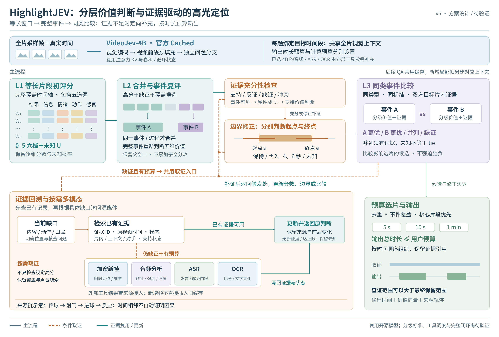

# HighlightJEV v5：分层评分、证据回溯与边界修正

更新于 2026-11-12。根据[分层框架方案](../../docs/highlightjev_agent_framework_plan_2026-11-12.md)更新图稿，沿用现成 VideoJev-4B、官方 Cached 和每维 **0–5 六档＋未知**。图中为拟实现的方法关系，不表示完整 Agent 已实现或取得实验收益。本轮没有新增实验模型调用或 GPU 任务。



## 文件与编辑

- [可编辑 SVG](highlightjev_agent_framework_v5.svg)：主编辑源，原生文本、形状与连接器按模块分组。
- [矢量 PDF](highlightjev_agent_framework_v5.pdf)：280 × 189.54 mm，适合横向报告或整页阅读。
- [PNG 预览](highlightjev_agent_framework_v5.png)：3400 × 2302 像素。
- [生成程序](create_diagram.py)：Python 标准库生成 SVG；重新运行会覆盖对 SVG 的手动修改。
- [检查记录](validation.json)：文件结构、导出信息、哈希和助手视觉复查的范围；不是模型效果验证。
- [完整方案](../../docs/highlightjev_agent_framework_plan_2026-11-12.md)包含五维等级锚点、接口、消融及运行前仍需冻结的设置。[此前 v4 图稿](../videojev_agent_framework_20261112_v4/README.md)保留。

## 如何阅读

### 1. 三个评分层级

**L1 等长窗口**覆盖全时间轴，每窗分别判断结果、信息、情绪、动作、感官五维，保存六档与未知的完整概率。矩阵色块只示意维度，不代表实验分数。

**L2 完整事件**保留高分、缺证和覆盖候选，仅将同一事件或过程的窗口合并；合并后重新评价完整事件。保留原窗口来源，不累加子窗口分数，避免长片段天然占优。

**L3 同类比较**在有共同标准的事件之间比较。A 优、B 优、并列和缺证分开；并列需要双方证据充分，不能把两边未知变成 tie。不同事件类型先检查比较资格，最终跨类选择结合绝对价值、覆盖和时长。

### 2. 证据回溯与返回路径

橙色虚线汇集价值判断、边界和比较中的缺证请求。下方模块先确定“哪里缺什么”，再检索已有记录；可用证据直接复用，仍不足且有预算时才调用工具。青色路径把已有或新增证据送入“更新并返回原判断”。

该框是共享机制的返回端：回到此次请求的发起模块，只更新受影响的分数、端点或比较，不重新计算整条视频。为避免回线穿过主干，图中用返回端标签表示这一关系。记录证据 ID、原始时间、模态、片内/上下文/对手角色和支持状态；来源链中的时间邻接不自动证明因果。

### 3. 按需多模态

四个工具共用一个入口和结果出口，按缺口选择一个或多个：新帧处理瞬时动作，音频分析处理欢呼及反应，ASR 处理话语，OCR 处理文字变化。不是依次强制调用四种工具，也不只检查视觉高分片段；覆盖候选和声音线索帮助发现视觉平静的有效内容。

**当前选定的 MCG-NJU / ZhuYuhan VideoJev-4B 官方 QA 用法只使用视频帧，不使用音频或字幕。** 音频分析、ASR、OCR 是本框架拟接入的外部工具，结果带来源进入问题与证据记录，其适配效果尚未验证。[官方用法](https://huggingface.co/ZhuYuhan/VideoJev-4B/blob/main/USAGE.md)

顶部复用的是[官方 Cached 视频前缀](https://github.com/MCG-NJU/VideoJev/blob/7f8b38aa7df67721303cdc61f06d8435f3c7db89/timejev/asymmetric_video_memory.py)，包括注意力 KV 与卷积/循环状态，不是先生成文本背景。新增局部帧需建立对应上下文，不能假定可以直接插入旧缓存。JEV 的选项概率本身也不是生成式的事实解释。

### 4. 边界与输出预算

开始和结束端点分别选择保持、提前/延后 2/4/6 秒或未知。双向箭头表示扩展和收缩；实际修正必须有附近源帧或音频依据，并检查联合区间合法性。停止补证后仍缺证的端点保留未知，不强行改动。

最终去重、覆盖并选择核心片段，输出总时长不超过用户预算。右下两条时间带强调：**取证范围可以大于最终保留范围**。5 秒、10 秒、1 分钟是输出预算示例，不是已冻结的实验设置，也不是 Top-5 mAP 的评价单位。

## 相对 v4 的调整

1. 将笼统的候选细化展开为等长窗口、事件合并复评、同类比较三个层级。
2. 增加共享证据请求入口、已有记录检索、外部工具分支与判断更新返回端。
3. 将边界细化画成独立的起点/终点双向动作，并显示取证和输出范围的区别。
4. 明确已选模型的视觉输入范围，区分官方缓存与本项目新增多模态适配。
5. 保留五维分级、未知、停止条件及两种预算的区别，不将候选限定为 Top-5。

## 再生成与检查

使用现有 Python 3、Inkscape 1.1.2 和 Noto Sans CJK SC 字体，在本目录执行：

```bash
python create_diagram.py
inkscape highlightjev_agent_framework_v5.svg --export-type=png --export-width=3400 --export-filename=highlightjev_agent_framework_v5.png
inkscape highlightjev_agent_framework_v5.svg --export-type=pdf --export-filename=highlightjev_agent_framework_v5.pdf
```

已查看实际渲染图，修正“连线像只选音频、只由 OCR 返回”的歧义，为四类工具增加共享边界；边界箭头由只向外扩展改为双向调整。随后复看最终 PNG 与 PDF 渲染，未发现文字遮挡、裁切或错接。

SVG 有 100 个文本对象、20 个语义分组，无嵌入位图；PDF 单页、字体已嵌入、无嵌入位图。代码语法与画布范围检查通过。视觉延续 v4 的配色和字体，参考 [SAM 2 Figure 3](https://proceedings.iclr.cc/paper_files/paper/2025/file/45c1f6a8cbf2da59ebf2c802b4f742cd-Paper-Conference.pdf) 的共享状态和反馈关系，所有结构均自行绘制，未复制论文图像。
