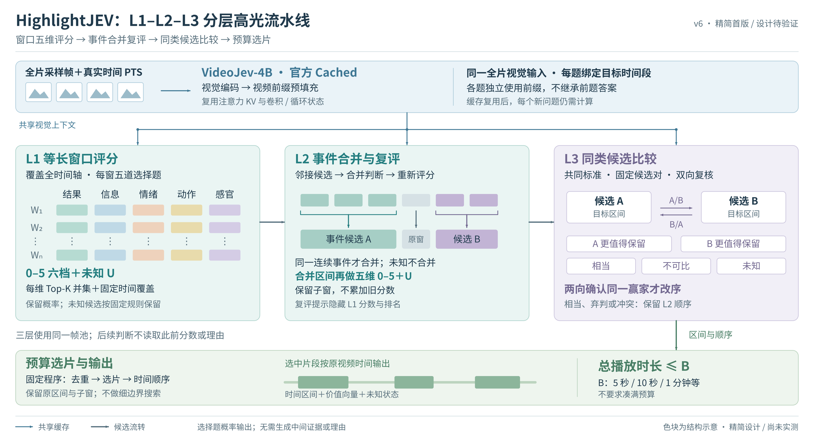

# HighlightJEV v6：L1–L2–L3 精简框架图

日期：2026-11-12。按用户确认的[精简修订方案](../../docs/highlightjev_l1_l2_l3_revised_report_2026-11-12.md)更新；[简要概览](../../docs/highlightjev_l1_l2_l3_mvp_2026-11-12.md)提供实施顺序。本图是待实现、待验证的设计，不表示已运行三层实验。



## 可编辑文件

- [SVG 主编辑源](highlightjev_l123_framework_v6.svg)：原生文字、形状、连接器和语义分组，未将主图嵌入为位图。
- [矢量 PDF](highlightjev_l123_framework_v6.pdf)：280 × 150.77 mm。
- [PNG 预览](highlightjev_l123_framework_v6.png)：3400 × 1831 像素。
- [生成程序](create_diagram.py)：Python 标准库；再次运行会覆盖对 SVG 的手动修改。
- [结构与导出检查](validation.json)：记录矢量对象、字体、文件哈希和视觉复查范围，不是模型效果验证。

## 图中各部分

**共享上下文。** 固定全片采样帧和真实 PTS，复用 VideoJev-4B 官方 Cached 的视频前缀。蓝色连线分别送入 L1、L2、L3，表示各层读取相同视觉上下文。每题独立执行，不继承前题答案；缓存复用后，新问题仍有后缀计算成本。当前所选模型按视觉输入设计。

**L1：等长窗口五维评分。** 每窗分别评估结果、信息、情绪、动作、感官，输出 0–5 六档＋未知的选项概率。矩阵的色块只是维度示意，不是实验得分。候选由每维 Top-K 并集、固定时间覆盖和预定未知保留规则产生，不限定总分 Top-5；具体配额待协议冻结。

**L2：合并与事件复评。** 仅在模型认为邻接片段属于同一连续事件时合并，另受最大时长等程序约束。图中灰色原窗保留，强调未知不合并，也不因此删除候选。新合并区间重新询问五维价值；不累加子窗分数。原子窗继续保存，区间使用父窗外包络；本版没有精细边界搜索。

**L3：有限同类比较。** 对有共同标准的固定候选对做 A/B、B/A 两向判断，输出 A优、B优、相当、不可比或未知。仅两向确认同一赢家时才允许改序；相当、弃判或冲突保留 L2 顺序。图中两条箭头表示两道独立问题，不是把前一次回答传给后一次。L2/L3 提示不展示此前分数或名次；程序仍保留它们用于候选派发及审计。

**预算输出。** 固定程序去重和选片，再按原视频时间输出，总时长不超过 B。5秒、10秒、1分钟是用户预算示例，不是已经冻结的实验设置，也不是 mAP 的 Top-K。过长候选如何使用保留子窗、稠密分数如何导出等规则，均按修订文档在运行前冻结。

## 相对 v5 的修订

1. 主图收敛为共享缓存、三个判断层级和预算输出；移出 Agent 控制器、证据核验/回溯、按需多模态和边界动作。
2. 显式画出缓存到三层的连接，避免后续层只读取旧分数的误解。
3. 合并图保留未合并原窗，区分新事件复评与分数累加。
4. 比较输出分为五项，明确双向赢家一致及保留原序规则。
5. 仅记录程序可得到的概率、时间和候选关系，不要求模型生成证据或理由。

[v5 完整 Agent 图](../videojev_agent_framework_20261112_v5/README.md)保留为未来扩展，不覆盖。此次图文更新没有新增实验模型调用或 GPU 任务。

## 再生成与视觉检查

使用现有 Python 3、Inkscape 1.1.2 和 Noto Sans CJK SC 字体，在本目录执行：

```bash
python create_diagram.py
inkscape highlightjev_l123_framework_v6.svg --export-type=png --export-width=3400 --export-filename=highlightjev_l123_framework_v6.png
inkscape highlightjev_l123_framework_v6.svg --export-type=pdf --export-filename=highlightjev_l123_framework_v6.pdf
```

图稿沿用 v5 的字体与蓝/青/紫/绿配色；结构参考 [MambaVision Figure 2](https://openaccess.thecvf.com/content/CVPR2025/papers/Hatamizadeh_MambaVision_A_Hybrid_Mamba-Transformer_Vision_Backbone_CVPR_2025_paper.pdf) 的横向阶段节奏和模块分组，只借用布局关系，全部对象自行绘制，未复制论文图像。

已查看实际 PNG 和 PDF 渲染，逐条检查共享连接、合并支路、双向比较及输出箭头。将初稿中可能含糊的“两向一致”改为“确认同一赢家”，并明确相当也保留原序。最终导出保留可编辑文本和矢量对象，检查范围见 validation.json。
